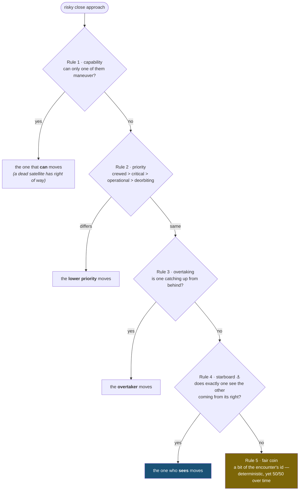

<div align="center">

# ⚓ Starboard

### The Rules of the Orbital Road

**An open, deterministic collision-avoidance protocol for satellites.**
Two spacecraft from different operators, with no radio contact, each work out
alone *which one should move out of the way*, and both always get the same
answer.

[](https://github.com/Tokeloshe/starboard-protocol/actions/workflows/ci.yml)
[](docs/CONFORMANCE.md)
[](tools/bitcheck.sh)
[](docs/evidence/CROSS-ARCH.md)
[](docs/evidence/PROOFS.md)
[](docs/evidence/MISRA.md)
[](LICENSE)
[](docs/DESIGN.md)

</div>

<p align="center">
  <a href="https://tokeloshe.github.io/starboard-protocol/">
    
  </a>
  <br>
  <sub>Every number on screen comes from <code>starboard_crossing_demo</code> and <code>murmuration</code>.
  <a href="https://tokeloshe.github.io/starboard-protocol/">Open the interactive player</a> to pause, scrub and jump between chapters.</sub>
</p>

---

## The idea in one minute

**The problem.** There are about 10,000 working satellites in orbit today,
and plans for over 100,000. When two satellites from *different* companies
are about to pass too close, operators still sort it out by **email**. That
doesn't scale, and it fails when someone is slow, unreachable, or the link
is down.

**The idea is 150 years old.** Ships solved this at sea with the
*rules of the road* (COLREGS). When two vessels cross, the one that sees the
other on its **starboard** (right) side gives way. Both captains look at the
same situation and reach the same conclusion. Nobody has to call anybody.

**Starboard does that for satellites.** Each satellite receives the standard
close-approach warning (a *Conjunction Data Message* from a tracking
provider) and runs Starboard on board:

1. 🛰️ It computes the risk of collision.
2. ⚖️ It applies five simple rules to decide who gives way.
3. 🔁 Both satellites get the **exact same answer, down to the last bit**, so
   exactly one of them moves. No messages needed.
4. ↩️ The one that moves makes the smallest possible burn, then glides back
   to its slot.
5. 🐦 It tells its neighbours, and they pass it on, so the whole
   constellation knows, like a flock of birds turning together.

```
                        ORBX-9  ●
                                 ╲   45° crossing, 150 m apart at closest approach
                                  ╲
                 who gives way?    ╲            each craft, alone, computes:
                                    ╲
        ACME-1  ●━━━━━━━━━━━━━━━━━━━━╳━━━▶     Pc        = 0x3F5117B3E9975E2E
                                    ╱ ╲         verdict   = ACME-1 gives way
                    ·  ·  ·  ·  · ╱ ·  ╲        same bits, both sides,
                  min-Δv burn,   ╱      ╲       zero bytes exchanged
                  then back to  ╱        ▼
                  its slot  ⤺  ╱
```

## Try it in 60 seconds

You need a C/C++ compiler, CMake and `make`.

```bash
git clone https://github.com/Tokeloshe/starboard-protocol && cd starboard-protocol

# 1. Two rival satellites avoid each other, with zero communication
cmake -B build && cmake --build build && ./build/starboard_crossing_demo

# 2. Feed it a real-format collision warning (CCSDS CDM) and see the decision
make -C ports/c && ports/c/sbctl cdm examples/cdm/shell_vs_debris.cdm --verified

# 3. Watch a 72-satellite flock learn about one satellite's maneuver
ports/c/murmuration
```

What the flock demo shows: one satellite dodges a dead fragment and announces
it. The news ripples through the inter-satellite links, hop by hop (`*` =
just heard, `#` = already knew), until every satellite holds the same picture.

```text
   hop  1  #*.........**...............................................*...........   5/72 know
   hop  3  ###*.....*####*.......*##*.........**...........#*.........*##*.......*#  24/72 know
   hop  6  ######*##########*.*########*...*######*.....*######*...*########*.*####  59/72 know
   hop  9  ##########################################*#############################  72/72 know

   flock ledgers: ALL 71 IDENTICAL (digest 1E3AC8C816631BCF on every satellite)
   0 conflicts; closest neighbour P5S01 stays 317 km away -> nobody else moves
```

## Is it ready to put on a satellite?

**Short answer: it is ready for a hardware-in-the-loop test campaign and a
demonstration mission in "shadow mode", where it decides and reports but a
human approves every burn. It is not yet flight-proven.** Here is exactly
what that means.

| ✅ Done and verified in software | ⏳ Still needed before flight |
|---|---|
| A complete C99 **flight library**: 43 KB of code, 25 KB RAM, no heap, no recursion | Running on **real flight hardware** (all evidence so far is emulation) |
| Reads standard **CCSDS conjunction messages**, exactly the same on every computer | An independent **verification & validation** campaign / certification |
| **Built-in self-test** at every boot: a computer that would get the maths wrong refuses to fly | A **registry service** run by a neutral party, and data-provider partnerships |
| **Radiation tolerance**: every decision is computed twice and compared bit for bit, with a 2-of-3 vote on any mismatch | A demonstration mission |
| Same bits on **11 CPU architectures** (incl. the RAD750-class PowerPC used on Mars rovers) and on bare-metal **CubeSat microcontrollers** | Timing measured on the actual flight processor |
| **Machine-checked proof** that both satellites always agree (CBMC) | Machine-checked proofs of the other three theorems |
| **Fuzzed** with ~129 million hostile inputs; **MISRA C:2012**-checked | A professional crypto audit |
| Speaks standard **CCSDS telemetry**; integrates with NASA cFS, F′ or bare metal | |

The honest, detailed list is [`docs/OPEN-PROBLEMS.md`](docs/OPEN-PROBLEMS.md).
The proof behind every ✅ is in [`docs/ASSURANCE.md`](docs/ASSURANCE.md),
one row per claim, each with the command that reproduces it.

## What's in the box

| Folder | What it is |
|---|---|
| [`docs/DESIGN.md`](docs/DESIGN.md) | ★ **The specification**: the rules, four theorems, every constant |
| [`docs/FLIGHT.md`](docs/FLIGHT.md) | **How to put it on a spacecraft**: API, memory, modes, self-test, telemetry |
| [`ports/c/`](ports/c/) | The **C99 flight library** (`libstarboard.a`), the `sbctl` ground tool, the flock demo |
| [`core/include/starboard/`](core/include/starboard/) | The **C++17 reference** implementation (header-only) |
| [`conformance/`](conformance/) | The conformance suite: what "Starboard compatible" means, precisely |
| [`examples/`](examples/) | The crossing demo, the murmuration demo, sample CDMs |
| [`verification/`](verification/) | CBMC proofs and fuzzers |
| [`tools/`](tools/) | The bit-check matrix, cross-architecture and bare-metal campaigns, MISRA |

---

## How it works

### The five rules

When a close approach is risky (collision probability ≥ 1 in 10,000, or a
predicted miss under 1 km), each satellite walks the same chain of rules.
The first rule that decides, decides, and there is always exactly one answer:



Both satellites evaluate the rules on the **same ordered pair** (sorted by
their international designators), so agreement isn't hoped for: it's true
*by construction*. That is Theorem 1, now **machine-checked**. It is one of
four, each with a proof short enough to check by hand:

| # | Theorem | What it means in practice |
|---|---------|---------------------------|
| 1 | **Agreement**: both satellites always reach the same verdict | no standoffs, no "after you", no "no, after you" |
| 2 | **Mistakes are safe**: if both wrongly move, their burns push them *apart* | the failure mode is extra distance, never a collision |
| 3 | **Reversible**: the dodge is undone exactly by two return burns | the fuel cost is small and known in advance |
| 4 | **Crowds work**: 3+ satellites resolve in one deterministic pass | no cascading re-planning |

### Trust without trusting anyone

Rules 1 and 2 use claims a satellite could fake ("I can't maneuver",
"I'm crewed"). Starboard's answer: **every unverified claim falls back to
physics.** A satellite whose claim can't be checked is treated like debris:
you avoid it. Claims can be verified fully offline against a signed registry
([`docs/REGISTRY.md`](docs/REGISTRY.md)), with verify-only crypto, so no
signing key ever flies. Even a forged verdict can only change *who* spends
fuel; it can never steer anyone into anything (Theorem 2).

### The flock (Layer 4)

Starlings in a murmuration never hold a meeting: each bird watches its
neighbours, and a turn ripples through the flock. When a Starboard satellite
commits to a maneuver, it broadcasts a tiny **maneuver notice** (204 bytes).
Neighbours relay it hop by hop and keep a shared **flock ledger**, and each
one checks the mover's new path against its own. In a tight formation (the
demo's 8-satellite cluster, 2 km apart) the flock spots that one satellite's
dodge would sweep through its neighbours. Every member agrees on who is
affected, and the cluster screens alternative plans against the whole flock
until it finds one that keeps everyone clear.

The flock **warns, it never decides.** Every satellite holding the same
warning can already predict its neighbour's move bit for bit, so a forged
notice can cost at most a re-check. Details: [`docs/DESIGN.md` §7.7](docs/DESIGN.md),
wire format [`docs/PROTOCOL.md` §6](docs/PROTOCOL.md).

### Why "the same bits" is a big deal, and how it's proven

"Roughly agrees" isn't good enough: a one-bit difference near a threshold
could make *both* satellites think the other will move. Starboard pins
everything that affects the verdict, then measures it:

- a **quantization lattice** snaps inputs so tiny decoding differences can't
  flip a decision;
- only IEEE-exact operations plus **two pinned functions** (`exp`,
  `sin/cos`) defined operation by operation, with no library maths and no
  fused multiply-add;
- **exact decimal ingest** of CDMs: no `strtod`, provably correctly rounded;
- a **J2 propagator** and **Patera's collision-probability integral**,
  accurate to ~10⁻¹² against an independent reference.

```text
$ tools/bitcheck.sh
OK    g++ / clang++   × -O0 … -O3 -march=native   (C++17 reference, v1 + v2 transcripts)
OK    gcc / clang / cc × -O0 … -O3 -march=native  (independent C99 port, v1 + v2)
bitcheck: ALL 58 TRANSCRIPTS BIT-IDENTICAL

$ tools/crossarch.sh       # 11 CPU architectures under QEMU
x86-64 · x86-32 · AArch64 · ARMv7 · ARMv5 soft-float · PowerPC 32 BE (RAD750-class)
PPC64LE · RISC-V 64 · SPARC64 · MIPS32 BE · s390x          → one set of bits
CONTROL x87, CONTROL FMA, FINDING libgcc soft-float          → refused by self-test

$ tools/baremetal.sh       # no operating system
Cortex-M7 · Cortex-M4F · Cortex-M3                           → one set of bits
```

**A real find along the way.** Testing on FPU-less ARM chips revealed that
the standard GCC library routine for double-precision addition
(`__aeabi_dadd`) rounds wrong in one rare case (an exponent gap of exactly
33). Starboard's maths hits that case, so two such satellites would
silently disagree with everyone else. The boot self-test now catches it, and
Starboard ships a correctly-rounded replacement, verified on 49 million
cases. Full write-up: [`docs/evidence/CROSS-ARCH.md`](docs/evidence/CROSS-ARCH.md).

### Two implementations, one set of bits

| | `core/include/starboard/` | `ports/c/` |
|---|---|---|
| Language | **C++17**, header-only | **C99**, MISRA C:2012-checked |
| For | Linux-class flight computers, ground tools | CubeSats, rad-hard MCUs, NASA cFS, F′ |
| Includes | the protocol + CDM binding | the protocol + CDM binding + flight layer + flock |
| Verified | 20 conformance vectors, sanitizers | both transcripts byte-for-byte, 11 architectures, bare metal, fault injection, fuzzing, CBMC |

### Why a fork can't quietly "improve" it

A give-way convention only works if everyone computes the same answer. So
the constants, the operation order and the ruleset version are hashed into
every encounter's id. A modified copy can't even *name* encounters
consistently with everyone else, fails the conformance suite, and loses the
one property that made it worth running. Full argument:
[`docs/DESIGN.md` §11](docs/DESIGN.md) and [`docs/STRATEGY.md`](docs/STRATEGY.md).

## Documentation map

| You are… | Start with |
|---|---|
| Curious | this page, then `./build/starboard_crossing_demo` and `ports/c/murmuration` |
| An engineer evaluating the design | [`docs/DESIGN.md`](docs/DESIGN.md), the normative spec |
| Putting it on a spacecraft | [`docs/FLIGHT.md`](docs/FLIGHT.md) |
| Checking the claims | [`docs/ASSURANCE.md`](docs/ASSURANCE.md) and [`docs/evidence/`](docs/evidence/) |
| Implementing it yourself | [`docs/DESIGN.md`](docs/DESIGN.md) §3–§5, then [`docs/CONFORMANCE.md`](docs/CONFORMANCE.md) |
| Deciding whether to depend on it | [`docs/OPEN-PROBLEMS.md`](docs/OPEN-PROBLEMS.md) |

If you implement the spec and your bits disagree with the transcript,
**that is the most valuable bug report this project can receive.** See
[`CONTRIBUTING.md`](CONTRIBUTING.md).

## Licensing

The **specification** (`docs/`) is CC BY 4.0: free to implement forever,
because a convention only works if everyone can adopt it. The **reference
code** is AGPL-3.0-or-later; proprietary flight or ground software can
license it commercially instead ([`COMMERCIAL-LICENSE.md`](COMMERCIAL-LICENSE.md)).
Conformance and certification carry the `Starboard Certified™` mark.

## Citing Starboard

If Starboard helps your research, please cite it. GitHub's **"Cite this
repository"** button uses [`CITATION.cff`](CITATION.cff); machine-readable
metadata is in [`codemeta.json`](codemeta.json).

> James H (Tokeloshe). *Starboard: an open, deterministic give-way protocol
> for satellite collision avoidance*, v0.6.0, 2026.
> https://github.com/Tokeloshe/starboard-protocol

**Topics:** space traffic management · satellite collision avoidance ·
conjunction assessment · CCSDS conjunction data message · probability of
collision · right of way · COLREGS · autonomous satellites ·
mega-constellations · Starlink · flight software · MISRA C · NASA cFS ·
CubeSat · formation flying · swarm coordination · space debris ·
deterministic computing · IEEE 754 reproducibility

## ☕ Support Starboard

This is an independent, one-person project: the spec, the maths, both
implementations, the flight library and all of the evidence. If it's useful
to you, or you just want more open, rigorously engineered space
infrastructure to exist, you can fuel the next revision:

<div align="center">

[](https://buymeacoffee.com/Tokeloshe)

*Starring the repo, filing a sharp issue, or implementing the spec in your
language of choice are equally appreciated ways to help.*

</div>

---

<div align="center">
<sub>⚓ <b>Starboard</b>: because the orbital road needs rules, and rules need bits that agree.</sub>
</div>
