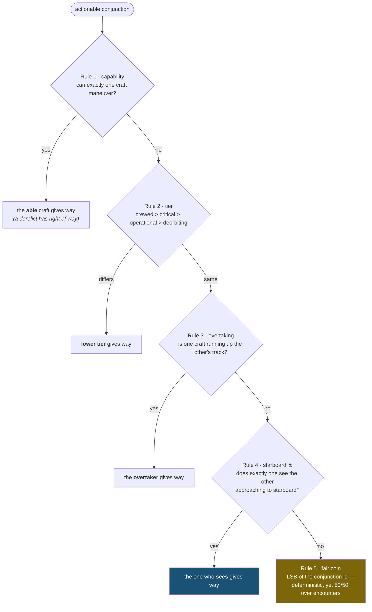

<div align="center">

# ⚓ Starboard

### The Rules of the Orbital Road

*An open, deterministic give-way protocol for satellites — two spacecraft from
rival operators, with **no radio contact**, independently compute the **same
answer** for who moves out of the way.*

[](LICENSE)
[](docs/DESIGN.md)
[](core/include/starboard/)
[](ports/c/)
[](docs/CONFORMANCE.md)
[](tools/bitcheck.sh)
[](https://buymeacoffee.com/Tokeloshe)

</div>

---

At sea, this problem was solved 150 years ago. When two vessels cross, the one
that has the other to **starboard** gives way — both skippers compute the same
answer from the same geometry, no negotiation required. That single convention
(COLREGS) is why millions of ships share the water without a central traffic
controller.

Low Earth orbit has no such convention. ~10,000 active satellites today,
credible plans for 100,000+, and cross-operator close approaches are still
resolved by **email**. Starboard is the missing rule of the road:

```
                        ORBX-9  ●
                                 ╲   45° crossing, 150 m apart at closest approach
                                  ╲
                 who gives way?    ╲            each craft, alone, computes:
                                    ╲
        ACME-1  ●━━━━━━━━━━━━━━━━━━━━╳━━━▶     Pc        = 0x3F5117B3E9975E2E
                                    ╱ ╲         verdict   = ACME-1 gives way
                    ·  ·  ·  ·  · ╱ ·  ╲        same bits, both sides,
                  min-Δv burn,   ╱      ╲       zero bytes exchanged
                  then back to  ╱        ▼
                  its slot  ⤺  ╱
```

1. **Both craft compute the identical verdict** from shared, symmetric inputs
   — down to the last bit. No communication is required for correctness.
2. **Comms only confirm, they never decide.** A jammed link changes nothing.
3. **The give-way craft flies a minimum-Δv burn** and afterwards flocks back
   to its assigned slot, like a murmuration settling.

## See it happen

```
cmake -B build && cmake --build build && ./build/starboard_crossing_demo
```

Two rival satellites are placed on genuinely crossing orbits and left alone —
everything below is *found and decided* independently on each side:

```text
 T-015:00  both on-board searches sweep the 1024 s arc (J2):
   ACME-1   TCA in 900.000 s   miss  150.0 m   Pc = 1.043e-03
   ORBX-9   TCA in 900.000 s   miss  150.0 m   Pc = 1.043e-03
   Pc bits  ACME 0x3F5117B3E9975E2E | ORBX 0x3F5117B3E9975E2E  IDENTICAL [ok]

 T-015:00  each runs the Rules of the Orbital Road:
   ACME-1   verdict: I GIVE WAY   (Rule 4 - starboard)
   ORBX-9   verdict: I STAND ON   (Rule 4 - starboard)
   independent agreement: 2026-001A gives way  [ok] no message needed

 T-014:40  give-way craft plans min-dv burn (Hill/CW):
   dv = 1.012 m/s   [naive linear impulse would cost 1.256 m/s -> CW saves 19%]

 T+000:00  TCA - closest approach 1280.0 m >= R_SAFE 1024 m  [ok]

 T+272:03  burn 2 (0.370 m/s): offset 0.000 m, drift 0.000000 m/s - in slot
   fuel: give-way 1.012 + return 1.677 = 2.689 m/s total
```

Act II adds a dead upper stage to the window — three craft, two conjunctions,
resolved in one deterministic pass, still without a byte exchanged.

## The rules, in one picture

When a close approach is **actionable** (probability of collision ≥ 10⁻⁴, or
predicted miss inside the safety radius), each craft walks the same chain.
The first rule that decides, decides; the chain is *total* — there is always
exactly one give-way craft:



Every predicate is computed from **shared inputs** (a conjunction data message:
both states + covariances at a common epoch) on a **canonical pair ordering**,
so agreement isn't hoped for — it's true *by construction*. That's Theorem 1,
and it's one of four, each with a proof short enough to check by hand:

| # | Theorem | What it buys you |
|---|---------|------------------|
| 1 | **Agreement & totality** — `evaluate(A,B) ≡ evaluate(B,A)`, always defined | no geometry, however degenerate, produces a standoff or a contradiction |
| 2 | **Lies are safe** — if *both* craft maneuver (trust divergence), their burns oppose | the failure mode of disagreement is *extra* clearance, never collision |
| 3 | **Reversible maneuvers** — the give-way burn is undone *exactly* by a mirror+phase return | fuel cost is bounded and known in advance: ≈ Δv·(2 + 2/N) |
| 4 | **Multi-body convergence** — N-craft windows resolve in one deterministic pass | no cascading re-planning, no oscillation |

## Determinism you can bank on

The product claim is not "roughly agrees" — it is **bit-for-bit identical**
across vendors. That claim is engineered, then measured:

- **A quantization lattice** (all quanta exact powers of two) snaps shared
  inputs so sub-quantum noise can't flip a verdict.
- **A strict arithmetic profile**: the verdict path uses only IEEE-exact
  operations (`+ − × ÷ √`) plus exactly **two pinned transcendentals**
  (`canon_exp`, `canon_sincos`) defined operation-by-operation in the spec —
  no libm, no FMA contraction (pinned in-source *and* by build flag).
- **Physically honest determinism**: screening propagates a shared
  conjunction data message with a fixed-step **two-body + J2** integrator
  over a bounded arc where its error is ~1 m — agreement about *physics*,
  not about an extrapolated fiction.
- **Collision probability that's actually right**: encounter-plane Pc via
  **Patera's contour integral** — validated to ~10⁻¹² against an independent
  adaptive quadrature for *any* covariance shape, including the extreme
  along-track-elongated case that breaks series methods by double digits.

And the measurement:

```text
$ tools/bitcheck.sh
OK    g++ / clang++          × {-O0 -O1 -O2 -O3 -O3 -march=native}   (C++17 reference)
OK    gcc / clang / cc       × {-O0 -O2 -O3 -march=native}           (independent C99 port)
bitcheck: ALL 29 BUILDS BIT-IDENTICAL
```

Twenty-nine builds — two *languages*, two compiler families, every
optimization level — reduce to a single hash of a ~50,000-quantity
transcript. Cross-language agreement is the strongest evidence that the
**spec**, not an implementation accident, defines the bits.

## Two implementations, one set of bits

| | `core/include/starboard/` | `ports/c/` |
|---|---|---|
| Language | **C++17**, header-only | **C99**, MISRA-oriented |
| Flight class | Starlink-class (embedded Linux) | CubeSat / rad-hard MCU / NASA cFS |
| Discipline | allocation-free, exception-free, recursion-free | + no VLAs, fixed arrays, explicit widths |
| Verified | 21 conformance vectors, ASan/UBSan clean | reproduces the C++ transcript byte-for-byte |

```
starboard-protocol/
├── docs/
│   ├── DESIGN.md          ★ The specification — rules, theorems, constants (normative)
│   ├── PROTOCOL.md        Layer-2 wire format & optional handshake
│   ├── REGISTRY.md        Offline trust: signed assertions, Merkle log, revocation
│   ├── CONFORMANCE.md     What "Starboard Certified™" means, precisely
│   ├── OPEN-PROBLEMS.md   Honest ledger of what SB/1 does not yet settle
│   └── STRATEGY.md        Why open + why forking loses
├── core/include/starboard/   C++17 reference (canon, propagator, Pc, rules, …)
├── ports/c/               Independent MISRA-C99 port (cross-language proof)
├── conformance/           Vectors SB-001…020 + pinned bit transcript (normative)
│   └── validation/        Independent Pc reference (scipy) + scale demo
├── examples/crossing_demo.cpp
└── tools/bitcheck.sh      The 29-build bit-agreement matrix
```

## Trust, without trusting anyone

Rules 1–2 consume claims a craft could fake ("I cannot maneuver", "I am
crewed"). Starboard's answer is structural: **every unverified claim degrades
toward physics**. An unverifiable craft is treated as debris — you avoid it;
a spoofed tier clamps to default; and when nothing can be verified, the
decision falls through to stern-cone and starboard geometry, which can only
be "spoofed" by actually flying differently. Verification itself is fully
offline: a signed capability assertion chains through a Merkle registry log
to a root key carried on board (`docs/REGISTRY.md`) — verify-only crypto, no
signing key ever flies. Even a *forged* verdict can only reallocate who
burns fuel; it can never steer anyone into anything (Theorem 2).

## Why a fork can't quietly "improve" it

A give-way convention is valuable only if everyone computes the same answer —
so the constants, the operation order, and the ruleset version are hashed
into every conjunction id. A stack that tweaks *anything* normative no longer
even **names** encounters consistently with the installed base, fails the
conformance vectors, and forfeits the only property that made the thing
worth running. Deviation is a bug, not a differentiator. The full argument:
[`docs/DESIGN.md` §11](docs/DESIGN.md) and [`docs/STRATEGY.md`](docs/STRATEGY.md).

## Status — read this before depending on it

This is a **v0.5 draft** specification and reference implementation, published
to invite review, independent implementations, and adopters. The intellectual
core — deterministic, covariance-aware, provably-agreeing give-way from a
shared conjunction data message — is implemented, theorem-backed, and
conformance-tested. It has **not** flown, and
[`docs/OPEN-PROBLEMS.md`](docs/OPEN-PROBLEMS.md) is a frank list of what still
gates a real deployment (perturbation fidelity beyond J2, CDM provenance in
practice, registry operations, crypto audit, hardware validation).

If you implement from the spec and your bits disagree with the transcript —
**that is the most valuable bug report this project can receive.** See
[`CONTRIBUTING.md`](CONTRIBUTING.md).

## Licensing

Open core, honestly stated: the **specification** (`docs/`) is CC BY 4.0 —
free to implement forever, because a convention only works if everyone can
adopt it. The **reference code** is AGPL-3.0-or-later; proprietary flight or
ground software can license it commercially instead
([`COMMERCIAL-LICENSE.md`](COMMERCIAL-LICENSE.md)). Conformance +
certification carry the `Starboard Certified™` mark. Outside code
contributions need a CLA (see [`CONTRIBUTING.md`](CONTRIBUTING.md)) — that's
what keeps the dual license possible.

## ☕ Support Starboard

This is an independent, one-person project: the spec, the math, both
implementations, and the conformance suite. If it's useful to you — or you
just want more open, rigorously-engineered space infrastructure to exist —
you can fuel the next revision:

<div align="center">

[](https://buymeacoffee.com/Tokeloshe)

*Starring the repo, filing a sharp issue, or implementing the spec in your
language of choice are equally appreciated ways to help.*

</div>

---

<div align="center">
<sub>⚓ <b>Starboard</b> — because the orbital road needs rules, and rules need bits that agree.</sub>
</div>
