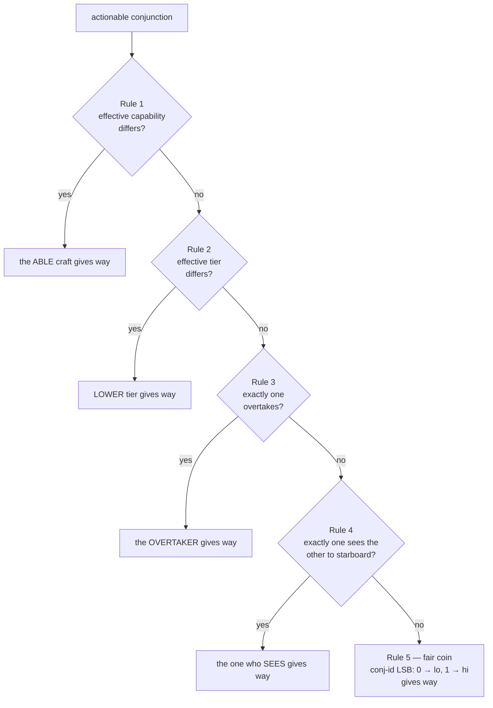

# Starboard Specification — The Rules of the Orbital Road

**Ruleset SB/1 · Specification v0.6 (draft) · `RULESET_ID = 0x53420001`**

*Specification text © 2026 James H, licensed CC BY 4.0. The reference
implementation in `core/` is dual-licensed AGPL-3.0 / commercial.*

---

## 0. Status and conventions

The key words **MUST**, **MUST NOT**, **SHALL**, **SHOULD**, and **MAY** are
to be interpreted as in RFC 2119. Sections marked *(informative)* do not bind
implementations; everything else is normative.

This document is written to be verified by inspection. Every claim the
protocol's safety depends on is stated as a numbered theorem with a proof
short enough to check by hand, and every constant an implementation needs is
pinned in §3.6 — there are no "implementation-defined" values on any path
that two spacecraft must agree about.

## 1. Design axioms *(informative)*

Two satellites facing a close approach must reach the **same** decision about
who gives way using only information both can independently know — even with
no communication. This mirrors maritime COLREGS: a skipper does not radio to
ask "should I give way?"; the geometry answers it. Four axioms follow:

1. **Determinism outranks optimality.** A slightly suboptimal maneuver that
   both craft agree on is safe; an optimal one they disagree on is a
   collision. Wherever this spec had to choose, it chose agreement.
2. **Communication confirms; it never decides.** Any link (Layer 2) may be
   jammed, delayed, or absent. The verdict must already exist without it.
3. **Determinism must survive uncertainty.** Real conjunction assessment is
   probabilistic (covariances, not points). The probability itself is
   therefore a *defined* quantity (§4.5): both craft compute identical bits.
4. **Lies degrade toward physics.** Any assertion a craft could fake is
   backed by a conservative default that preserves safety and pushes the
   decision toward unspoofable geometry (§8).

## 2. Architecture

```
┌──────────────────────────────────────────────────────────────────┐
│ Layer 7  MULTI-BODY WINDOW   deterministic cascade over 3+ craft │
├──────────────────────────────────────────────────────────────────┤
│ Layer 6  MANEUVER            min-Δv Hill-frame burn, reversible  │
├──────────────────────────────────────────────────────────────────┤
│ Layer 4  THE FLOCK           maneuver notices, shared ledger     │
├──────────────────────────────────────────────────────────────────┤
│ Layer 3  RETURN TO SLOT      mirror + phase; the flock settles   │
├──────────────────────────────────────────────────────────────────┤
│ Layer 2  HANDSHAKE           optional confirmation (PROTOCOL.md) │
├──────────────────────────────────────────────────────────────────┤
│ Layer 1  RULES OF THE ROAD   the deterministic give-way verdict  │
├──────────────────────────────────────────────────────────────────┤
│ Layer 0  SCREENING           TCA, miss geometry, Starboard-Pc    │
├──────────────────────────────────────────────────────────────────┤
│ Layer C  CANON               frames, ids, lattice, constants     │
└──────────────────────────────────────────────────────────────────┘
```

Layers C, 0, 1, 6, 7 require **no communication**. Layers 2–4 are
enhancements: they confirm, inform and warn, and never decide. (Layer numbers are stable names, not a contiguous stack.)

## 3. Layer C — canonical conventions

### 3.1 Frames

* The shared inertial frame is **GCRF** (ECI). All catalog states exchanged
  or screened MUST be expressed in it.
* The **Hill frame** (RIC) of a craft is: x̂ = radial (zenith),
  ẑ = orbit-normal (r̂ × v̂ direction), ŷ = ẑ × x̂ (along-track). Right-handed.
* The **body convention** for Rule 4 is: forward = velocity direction,
  down = −zenith, **starboard = down × forward = v̂ × r̂**. (Facing east with
  zenith up, starboard is south. The handedness is normative; the namesake
  rule depends on it.)

### 3.2 Object identity

A craft's canonical identity is a fixed **12-byte field**: the COSPAR
international designator, uppercase ASCII, left-justified, NUL-padded.
Identity comparison is bytewise unsigned lexicographic and defines a strict
total order over all craft. Every pairwise computation in this spec is
performed on the pair ordered by this comparison (§5.2). Ids MUST be unique;
`lo`/`hi` below always refer to this ordering.

### 3.3 Shared inputs — the conjunction data message

The determinism theorem rests on both craft computing from *identical*
inputs. That is a real requirement, not an assumption: if ACME screens
itself from its own GPS ephemeris and the counterpart from a public catalog,
while ORBX does the mirror, their inputs are **not** symmetric and agreement
is not guaranteed. Starboard therefore pins the *provenance*:

> The canonical shared input is a **conjunction data message (CDM)**: both
> craft's states and position covariances at a **common reference epoch**
> `t_ref`, together with hard-body radii, drawn from a **shared source**
> (a tracking/screening provider, a mutually-subscribed catalog, or a
> bilateral state exchange) that furnishes the *same bytes* to both craft.

Both craft MUST evaluate the verdict from the CDM, snapped to the lattice
(§3.4). A craft MUST NOT substitute private knowledge (its own better
ephemeris of itself, unpublished maneuver plans) into the verdict — better
data the other craft lacks is exactly how two honest implementations
disagree. Private data MAY inform *whether* to escalate to operators, and
MAY trigger requesting a fresh CDM; it never enters the shared computation.
This matches operational conjunction assessment, where a provider issues a
CDM per close approach and both operators work from it.

Layer 1 additionally consumes the two registry descriptors (tier,
capability, trust) and the TCA epoch derived from the CDM. The reference
epoch also bounds the propagation arc (§4.2), which is what keeps the shared
extrapolation physically valid.

### 3.3a The CDM binding (normative)

The shared input of §3.3 arrives in practice as a **CCSDS 508.0-B-1
Conjunction Data Message** in KVN text. Two craft that receive the same CDM
bytes MUST derive bit-identical shared inputs. The binding is pinned
(`ports/c/cdm.c` and `core/include/starboard/cdm.hpp`, two independent
implementations cross-checked by the v2 transcript and a differential
fuzzer):

1. **Identity.** `INTERNATIONAL_DESIGNATOR` (the COSPAR id of §3.2). If the
   CDM gives `UNKNOWN`, the identity is `CAT` followed by
   `OBJECT_DESIGNATOR`. Only `[A-Z0-9-]` is accepted, checked over every byte
   of the field. Both objects mapping to one identity is a rejection.
2. **Exact decimal ingest.** A numeric field is accepted only with at most
   15 significant digits and, after folding in the unit's power of ten
   (km → m is +3), a decimal exponent |e| ≤ 22. The mantissa M < 10¹⁵ < 2⁵³
   and 10^|e| ≤ 10²² are then exact binary64 values, and **one** IEEE
   multiply or divide yields the correctly rounded value (Clinger's fast
   path). `strtod` MUST NOT be used: libc decimal conversion is not uniformly
   correctly rounded. Out-of-grammar fields are rejected, not approximated.
3. **Epoch.** `TCA` in `YYYY-MM-DDThh:mm:ss[.f]` or `YYYY-DDDThh:mm:ss[.f]`,
   fractional seconds rounded half-to-even to the millisecond by exact digit
   comparison, then converted to GPS milliseconds by integer civil-calendar
   arithmetic and the pinned GPS−UTC table (18 s since 2017-01-01). A new
   IERS leap second is a binding revision.
4. **Frames.** GCRF / ICRF / EME2000 / TEME pass through. ITRF (any
   realization) maps by the **frozen-Earth rotation at TCA**:
   r_i = r_f, v_i = v_f + ω×r_f with ω = (0, 0, 7.292115×10⁻⁵ rad/s). This
   needs no Earth-orientation data, and its z-axis is the true pole that J2
   is symmetric about.
5. **Covariance.** The position block (`CR_R … CN_N`, m²) is rotated from RTN
   to inertial as C = Bᵀ K B, with B the Hill basis of the canonical state
   (§3.1), pinned expansion order (M = K B, then Bᵀ M; inner sums
   ascending), then quantized.
6. **TCA anchoring.** Screening back-propagates both TCA states by
   `CDM_BACKPROP_S = 512 s` with the canonical propagator and runs the §4.2a
   search forward over the full arc. The canonical integrator round-trips to
   well under a millimetre, so the encounter geometry the craft agree on is
   the **provider's** high-fidelity TCA geometry. The J2-only canonical
   model only *locates* the canonical TCA, which mitigates the
   dynamics-fidelity limitation of §4.2 for CDM input.
7. **Hard body.** `HBR` (m) if present, else 2 × `DEFAULT_HBR_M`.

The binding changes no pinned bit of SB/1: it defines a new input path.

### 3.4 The quantization lattice

Before any pairwise computation, shared inputs MUST be snapped to the
canonical lattice by round-to-nearest, ties-to-even:

| Quantity   | Quantum          | Value                  |
|------------|------------------|------------------------|
| position   | `Q_POS_M`        | 2⁻¹⁰ m (≈ 0.98 mm)     |
| velocity   | `Q_VEL_MPS`      | 2⁻²⁰ m/s (≈ 0.95 µm/s) |
| covariance | `Q_COV_M2`       | 2⁻²⁰ m²                |
| time       | `Q_TIME_S`       | 2⁻¹⁰ s                 |

Every quantum is an exact power of two, so every lattice point is exactly
representable in binary64 and quantization is idempotent. The lattice is why
two implementations fed the same catalog message compute the same bits: any
sub-quantum disagreement in decoding or unit conversion is erased at the
door. All dead-bands in §5 are ≥ 2¹⁰ quanta, so lattice rounding can never
flip a rule predicate.

### 3.5 The Strict Arithmetic Profile

On the **verdict path** — everything §4 and §5 compute — an implementation
MUST use IEEE-754 binary64 with round-to-nearest-even, MUST NOT use FMA
contraction, reassociation, or "fast-math" transformations, and MUST evaluate
expressions in the operation order this spec and the reference code pin
(dot products expand x, then y, then z; sums accumulate in ascending index
order). The only permitted operations are `+ − × ÷ sqrt` (all correctly
rounded per IEEE-754) and the pinned transcendentals `canon_exp` and
`canon_sincos` (§4.6). Library `sin`, `cos`, `exp`, `atan2`, `pow`, and `erf`
are **forbidden on the verdict path** — no libm guarantees correct rounding
for them. The verdict path needs `canon_sincos` in exactly one place, the
Patera Pc contour (§4.5); everywhere else it is `sqrt`/`canon_exp`/arithmetic
by construction. Off the verdict path (maneuver planning, §6) normal libm is
permitted; those quantities are checked to tolerances, not bits.

*Enforcing no-contraction (normative).* A fused multiply-add changes
verdict-path bits (a demonstrated `-mfma` build shifts the `pc-kernel` and
`verdict-sweep` folds), so a conformant build MUST disable FP contraction by
**both** mechanisms available to it: the in-source `#pragma STDC FP_CONTRACT
OFF` (honored by Clang and conforming C11 compilers — it holds even under
`-mfma`) **and**, on compilers whose C frontend ignores that pragma (GCC),
the `-ffp-contract=off` flag. The reference C++ build and the C99 port both
apply the belt-and-suspenders combination. Because both mechanisms are
build-time promises, the reference additionally ships a **runtime
self-check** (`canon::arithmetic_profile_ok()` / `sb_arithmetic_profile_ok()`):
with `a = b = 1 + 2⁻²⁷` and `c = −(1 + 2⁻²⁶)`, correctly-rounded evaluation
of `a·b + c` is exactly `0` while a fused multiply-add returns `2⁻⁵⁴`.
Flight software SHOULD run it at boot and refuse to produce verdicts on
failure; the conformance runner and the C99 transcript binary refuse to
start if it fails.

*Platform conformance, checked at boot (normative for flight).* The
contraction check above is one of eleven known-answer tests in the flight
self-test (`docs/FLIGHT.md` §5.1). The others are: an excess-precision probe
(x87-style double rounding), the full 12 290-value transcendental sweep, six
IEEE-754 rounding probes at exponent gaps 31–34, and end-to-end known answers
for the J2 search, the rule chain, the maneuver planner, SHA-512, Ed25519,
the CDM binding and a CRC of the canonical constants. A craft MUST NOT
produce verdicts on a platform that fails any of them. The cross-architecture
campaign found such a platform: ARM soft-float double addition (libgcc
`__aeabi_dadd`) misrounds at an exponent gap of exactly 33. The reference
ships a correctly-rounded replacement (`ports/c/softdouble.c`).

### 3.6 Canonical constants

All conformant implementations MUST use exactly these values
(`core/include/starboard/canon.hpp`):

| Symbol | Meaning | Value |
|---|---|---|
| `MU_EARTH_M3S2` | gravitational parameter | 3.986004418 × 10¹⁴ |
| `J2_EARTH` | Earth oblateness coefficient | 1.08262668 × 10⁻³ |
| `R_EARTH_M` | equatorial radius (WGS-84) | 6378137 |
| `R_SCREEN_M` | coarse screening gate | 8192 m (2¹³) |
| `R_SAFE_M` | required post-maneuver miss | 1024 m (2¹⁰) |
| `PC_ACTIONABLE` | Pc declaring a conjunction | 1.0 × 10⁻⁴ |
| `DEFAULT_HBR_M` | default hard-body radius | 10 m |
| `DEFAULT_VAR_M2` | covariance for silent craft | 10⁶ m² (σ = 1 km) |
| `PATERA_NODES` | nodes of the Pc contour integral | 32 (2⁵) |
| `VAR_FLOOR_M2` | plane-covariance eigenfloor | 1 m² |
| `OVERTAKE_COS` | stern-cone half-angle | 0.3826834323650898 (cos 67.5°) |
| `EPS_SPEED_MPS` | speed-ordering dead-band | 0.0625 m/s (2⁻⁴) |
| `EPS_BEARING` | approach-bearing dead-band (sine) | 0.0625 (2⁻⁴, ≈3.6°) |
| `EPS_LATERAL_M` | co-drift bearing dead-band | 1 m |
| `PROP_STEP_S` | fixed RK4 integrator step | 4 s (2²) |
| `SCREEN_ARC_MAX_S` | bounded screening arc | 1024 s (2¹⁰) |
| `SCREEN_STEP_S` | range-rate search grid | 32 s (2⁵) |
| `TCA_BISECT_ITERS` | TCA refinement depth | 48 (fixed) |
| `MANEUVER_MARGIN` | κ, burn target κ·R_SAFE | 1.25 |
| `RETURN_PHASING_ORBITS` | N in mirror+phase return | 2 |
| `TCA_BUCKET_MS` | conjunction-id time bucket | 16384 ms (2¹⁴) |
| `RULESET_ID` | identity of these rules | 0x53420001 |

These are not tuning parameters. They are part of the protocol's identity:
§11 explains why changing any of them removes an implementation from the
network.

### 3.7 Input domain and fail-safe handling (normative)

SB/1 is defined on finite inputs inside a physical domain. Implementations
MUST validate shared inputs before screening, and MUST report an invalid
input as an **input fault**, never as "no conjunction": a fault that reads as
"all clear" is the one failure mode a collision-avoidance system cannot
have. The flight layer rejects non-finite values, |r| ∉ [6 000, 50 000] km,
|v| ∉ [1, 20] km/s, negative variances and variances above 10¹⁴ m². The core
is additionally hardened so a bad input cannot hang or misbehave, and every
one of these changes is bit-neutral for valid inputs:

* `screen_orbits` rejects an arc with `!(arc > 0)`, so a NaN arc returns
  instead of looping forever;
* `propagate` returns its input unchanged for |dt| > `PROP_DT_MAX_S = 2²⁰ s`
  or a non-finite dt, instead of undefined behaviour in the step-count cast
  or an hours-long loop;
* Starboard-Pc applies **non-finite repair** (§4.4).

## 4. Layer 0 — screening and Starboard-Pc

### 4.1 Inputs

Screening operates on the canonical relative state at the candidate close
approach: `dr = r_B − r_A`, `dv = v_B − v_A`, both craft's quantized
covariances, and combined hard-body radius `R = hbr_A + hbr_B`. How a craft
*obtains* candidate neighbours (catalog, CDM feed, ISL ranging) is
implementation-defined; what it computes from the shared state is not.

### 4.2 The canonical propagator

Conjunctions are *found* by propagating both craft from the CDM reference
epoch along the **canonical propagator**: a fixed-step RK4 integration of
**two-body + J2 zonal** dynamics (`MU_EARTH`, `J2_EARTH`, `R_EARTH`;
`propagator.hpp`). The acceleration is purely algebraic (`+ − × ÷ sqrt`
only), so — unlike an analytic Keplerian solve, which needs sin/cos/atan2 —
**no transcendental is reachable on the propagation path**, and `canon_exp`
(in Pc) is the only pinned transcendental on the entire verdict path.

Determinism rests on three pinned choices (SPEC §3.5): (i) fixed step
`PROP_STEP_S`, with `floor(|Δt| / PROP_STEP_S)` whole steps of the signed
step then one partial step — so whole steps are identical regardless of the
target time and a flight implementation MAY march incrementally and still
bit-match a from-epoch re-integration; (ii) pinned RK4 stage order; (iii)
pinned intra-vector expansion order.

**Why J2, and why bounded (the error budget).** Pure two-body diverges from
real LEO motion catastrophically: at 552 km the *relative* miss error
between two craft both propagated two-body versus both propagated with J2
is ≈ 240 m at 5 min and tens of km within one orbit (J2 nodal regression
dominates, ∝ cos i). Determinism alone would then be agreement on a
*fiction*. Two design choices make the shared computation both deterministic
**and** physically valid:

1. **J2 in the propagator.** With J2 modelled, the residual versus a
   high-fidelity truth is dominated by unmodelled drag, which over the
   bounded arc is ≤ ~1 m even at worst-case density and ballistic
   coefficient. Higher zonals (J3 ≈ 2.5×10⁻³·J2) and the RK4 truncation at
   `PROP_STEP_S = 4 s` (< 0.1 mm over the arc) are smaller still.
2. **A bounded arc.** Screening runs only over `[t_ref, t_ref +
   SCREEN_ARC_MAX_S]`, `SCREEN_ARC_MAX_S = 1024 s`. Over this arc the total
   dynamics-model error is order **1 m** — a small fraction of `R_SAFE`
   (1024 m) and well inside any operational covariance. Longer lead times
   are handled operationally by **re-screening against a fresh CDM** as TCA
   approaches (rolling CDMs), never by extrapolating an unphysically long
   arc.

Drag is deliberately **excluded** from the canonical model: it depends on
un-pinnable atmosphere and vehicle parameters, so folding its bounded effect
into the covariance keeps the shared computation deterministic. Operators
SHOULD inflate the covariance by the documented dynamics-model bound for the
arc they screen. (Measured error budget: `conformance/validation`; the study
that set both constants is reproducible there.)

Non-elliptic states (energy ≥ 0) are outside SB/1 and are reported unbounded
by the prefilter (never screened out), then propagate under the same
integrator.

### 4.2a The canonical conjunction search

Normative algorithm (`screening.hpp`), per pair over `[0, arc]`,
`arc ≤ SCREEN_ARC_MAX_S`:

1. **Ring prefilter.** If the two periapsis/apoapsis bands (from vis-viva —
   algebraic, no atan2) are separated by more than `R_SCREEN`, the pair
   cannot conjunct: done. Rejects the overwhelming majority of catalog pairs
   with a few square roots and no propagation.
2. **Grid walk.** Propagate both craft with the canonical propagator and
   sample `g(t) = dr·dv` (the range-rate sign function) on the canonical
   grid `SCREEN_STEP_S = 32 s`. A range minimum lies in every step where g
   goes negative → non-negative. The step is far below the relative-dynamics
   timescale, so each step holds at most one extremum (verified: a
   54-geometry sweep finds zero missed conjunctions).
3. **Refine.** 48 fixed bisections on the sign of g inside the bracket;
   quantize the refined TCA to the lattice.
4. **Kernel.** Evaluate the encounter at the refined TCA: canonical states
   for both craft, `miss = r_B − r_A`, `‖miss‖ < R_SCREEN` to detect, then
   Starboard-Pc (§4.5). `t = 0` uses the inside-bubble semantics: already
   past closest approach but still inside `R_SCREEN` is a conjunction now.
5. **Inside-bubble fallback.** If the walk finds no sign change but the pair
   is inside `R_SCREEN` at `t = 0` (an approaching pair whose TCA lies
   beyond the bounded arc), the conjunction MUST still be reported at
   `t = 0`: proximity now is never waived by a distant TCA.

*Implementation note (non-normative).* Grid samples at exact multiples of
`SCREEN_STEP_S` may be marched incrementally (each 32 s sample is exactly 8
whole `PROP_STEP_S` steps, so the whole-step sequence — and therefore every
bit — is identical to propagating from the epoch, ~16× cheaper). Bisection
midpoints and any clamped final sample MUST use from-epoch propagation,
whose bits are the definition.

Every quantity in the walk is a shared, bit-deterministic function of the
CDM, so both craft find the same conjunctions with the same TCAs to the bit
(conformance SB-013 pins this end-to-end). The screener returns the
canonical **states at TCA** — Layer 1 evaluates the encounter, not the
epoch (§5.1).

*The linear kernel* (`geometry.hpp`) remains normative for the encounter
itself: given a relative state, `t_raw = −(dr·dv)/(dv·dv)` (0 when
co-drifting). A `t_raw` inside `(0, horizon]` is an encounter **at** the
closest approach: `t_ca := t_raw`, detected iff the miss there is inside
`R_SCREEN`. A `t_raw` outside that window — at/past closest approach
(`t_raw ≤ 0`) **or** beyond the horizon — is assessed **where you are now**:
`t_ca := 0`, miss := current separation, detected iff currently inside
`R_SCREEN` ("inside the bubble"). This covers both the receding pair that
has not yet cleared the bubble and the slowly-approaching pair whose TCA
lies past the horizon but which already sits inside the screening radius.
The kernel-level conformance vectors (SB-001…012) are specified in this
model.

```
            ORBX ●──────▶ v_B
                  ╲
                   ╲ relative track
     encounter      ╲            e₂ ▲
     plane ⊥ v_rel ──╳────        │
                    ╱ ╲ miss      ●──▶ e₁ = miss direction
        v_A ◀──────● ACME         (in-plane miss = (d, 0))
```

### 4.3 Covariance convention

Position covariances are 3×3 symmetric matrices in GCRF, quantized per §3.4.
The combined covariance is `C = C_A + C_B` (uncorrelated errors — the
standard CDM assumption). A craft that publishes no covariance MUST be
assigned `DEFAULT_VAR_M2 · I` (a deliberately pessimistic 1-km sigma:
silence buys you a wider berth, not a free pass).

### 4.4 The encounter plane (pinned basis)

If `‖dv‖ < 10⁻⁹` m/s the encounter plane does not exist and
`Pc := 1 if d < R else 0` (the R_SAFE floor in §4.7 still applies). Otherwise:

* `n̂ = dv/‖dv‖`
* `e₁* = miss/d` if `d > Q_POS_M`, else the **pinned perpendicular**: the
  unit vector obtained by Gram-Schmidt from the coordinate axis with the
  smallest |component| of n̂ (ties resolved x before y before z)
* `e₁` = Gram-Schmidt of `e₁*` against `n̂` (at an interior TCA miss ⊥ dv
  already; at a clamped TCA it need not be), falling back to the pinned
  perpendicular if degenerate
* `e₂ = n̂ × e₁`

The projected covariance is `a = e₁ᵀCe₁`, `b = e₂ᵀCe₂`, `c = e₁ᵀCe₂` (`a`
and `b` floored per §3.6), and the in-plane miss is `(d_p, 0)` with
`d_p = miss·e₁` — by construction the miss vector lies in span(n̂, e₁).

**PSD repair (normative).** If `c² > a·b` after flooring — a malformed or
hostile covariance whose projection is not positive-semidefinite — the
correlation MUST be dropped: `c := 0`. Without this repair the Cholesky in
§4.5 takes the square root of a negative number, Pc becomes NaN, and a NaN
compares false against `PC_ACTIONABLE` — a bad covariance would silently
*disable* the actionability gate. The determinant floor `det ≥ VAR_FLOOR²`
applies after the repair.

**Non-finite repair (normative).** If the projected `a`, `b` or `c` is NaN
or infinite, `Pc := 1`. A NaN Pc compares false against `PC_ACTIONABLE`, the
same gate-disabling failure PSD repair closes. Both craft hold the same bytes,
so both take this branch: the repair is fail-safe and symmetric.

### 4.5 Starboard-Pc (a defined quantity)

The classical 2-D encounter Pc is the integral of the projected Gaussian
over the hard-body disc. Starboard evaluates it by **Patera's
divergence-theorem reduction** to a 1-D contour integral, sampled at a fixed
`PATERA_NODES = 32` equally-spaced angles. Whiten the plane with the Cholesky
factor `L` of `C2⁻¹` (`sqrt` only — the standard normal's rotational
invariance makes any `W` with `Wᵀ W = C2⁻¹` valid, so no eigen-rotation and
no `atan2`):

```
det = a·b − c²                        (floored at VAR_FLOOR²)
C2⁻¹ = (1/det)·[[b, −c], [−c, a]]      L Lᵀ = C2⁻¹  (2×2 Cholesky)
disc: centre s_c = (−d_p, 0), radius R = r_hb, boundary s(φ)=s_c+R(cosφ,sinφ)
u(φ) = Lᵀ s(φ)                         (whitened boundary)

Pc = (1/2π) ∮ [1 − e^(−|u|²/2)] / |u|²  (u_x du_y − u_y du_x)
   = (1/N) Σ_{i=0}^{N−1} factor(φ_i)·(u_x u′_y − u_y u′_x),  φ_i = i·2π/N
```

evaluated with `canon_sincos` (node angles) and `canon_exp` (the exponential),
in the pinned ascending summation order of the reference implementation
(`covariance.hpp`). The removable pole at `|u|²→0` uses the pinned series
`(1 − e^(−w/2))/w = ½ − w/8 + …` below `2⁻²⁰`. `N = 32` is a power of two, so
the final `1/N` scaling is exact.

**Starboard-Pc is defined as this finite expression.** Unlike an
equivalent-area series (Chan), Patera's error is set by the node count, not
the covariance shape: `N = 32` matches an independent adaptive quadrature to
~1e-12 relative at meaningful Pc for aspect ratios up to 50:1 — the elongated,
along-track-dominated covariance that is the LEO norm and on which Chan's
circularization erred by 15–43% (`conformance/validation`). Conformance level
SB-C2 requires bit-equality against the pinned vectors.

*Sanity anchor (informative):* for zero miss and isotropic σ, Patera returns
`1 − e^(−R²/2σ²)`, the exact Rayleigh result (and matches the old Chan series
there to ~1e-15). Symmetric by construction: every term depends on
squares/quadratics of the relative geometry, so `Pc(A,B)` and `Pc(B,A)` are
the same bits.

### 4.6 The pinned transcendentals: `canon_exp`, `canon_sincos`

Both are defined operation-by-operation in `canon.hpp`:

* **`canon_exp`** — Cody-Waite range reduction with the fdlibm ln 2 split,
  a 13-term Taylor polynomial in pinned Horner order, an exact `ldexp`
  scale. Used by the Patera Pc integrand.
* **`canon_sincos`** — three-part Cody-Waite π/2 reduction (each split
  constant has its low 27 mantissa bits zeroed, so the products `k·PIO2_HI`
  and `k·PIO2_MED` are *exact* for |k| < 2²⁶), Taylor kernels on
  |r| ≤ π/4 in pinned Horner order, quadrant selection. Domain |x| ≤ 2²⁰.
  Used by the Patera Pc contour node angles (§4.5) and the Clohessy-Wiltshire
  maneuver dynamics (§6, `frames.hpp`).

These two are the only transcendentals a verdict depends on. Everything else
on the verdict path — the canonical propagator (§4.2) and the Layer-1 rule
predicates (§5) — is trig-free and exp-free by construction, using only
`+ − × ÷ sqrt`. `canon_sincos` reaches the bit-exact verdict path in exactly
one place: the Pc contour (§4.5).

Library `exp`/`sin`/`cos` MUST NOT be substituted — no libm guarantees
correct rounding, and one ulp of drift near a threshold is a cross-vendor
disagreement. The conformance suite pins bit anchors for both (SB-010,
SB-014), and the `--bits` transcript folds dense sweeps of each (§10).

### 4.7 Actionability

A detected conjunction is **actionable** — Layer 1 MUST be evaluated and its
verdict acted on — iff

```
Pc ≥ PC_ACTIONABLE   or   d_miss < R_SAFE_M
```

The second clause is a hard floor: an optimistic covariance is never allowed
to waive a predicted sub-kilometre miss. (With the canonical 20 m combined
hard body, Pc = 10⁻⁴ is reachable only for misses ≲ 1.2 km under
worst-case σ — the thresholds are mutually consistent by construction.)

### 4.8 Broad-phase (constellation scale)

Screening a catalog of N objects pairwise is O(N²) — infeasible at 10⁴–10⁵.
The **broad-phase** (`broadphase.hpp`) cheaply produces a candidate pair list
that is a strict **superset** of every pair the pairwise search (§4.2a) would
declare a conjunction, so the expensive per-pair work runs only on candidates.

**Stage 1 — radial-band sweep (normative, unconditionally complete).** Each
object gets a radial shell `[periapsis − M, apoapsis + M]` from the same
vis-viva `radial_bounds` the pairwise search uses; a pair is a candidate iff
its padded shells overlap. Sort by lower edge and sweep. With margin
`M = R_SCREEN`, recall is **1.0 unconditionally**: the pairwise search keeps a
pair only after its own ring gate (radial-interval separation ≤ R_SCREEN), and
two shells padded by M each overlap whenever that separation < 2M = 2·R_SCREEN
> R_SCREEN — so Stage 1's gate is a strict relaxation of the search's own gate,
computed by the identical function on the identical canonical state. It cannot
drop a pair the search keeps, for any speed/eccentricity/geometry (SB-020).

Unlike the verdict path, the broad-phase need **not** be bit-identical across
implementations: it only selects which pairs to screen; the per-pair verdict
stays deterministic and both craft still agree. Completeness is *per-craft*
(never miss a neighbour of self), which the superset property gives.

**Stage 2 — temporal spatial-hash (informative; the constant-factor pruner).**
Stage 1 decides in O(N log N) but emits a constant fraction (~7.5%) of N²
candidates on a dense band. Stage 2 samples each object's arc on the 32 s
grid, hashes the samples into cells of size `D = R_SCREEN + (v_max_a +
v_max_b)·(SCREEN_STEP/2)`, and pairs objects sharing a cell-neighbourhood at
the same slice. Using each object's provable periapsis speed (vis-viva) for
`v_max` makes the capture radius a true upper bound, so Stage 2 is also
unconditionally complete — no hardcoded speed limit. It **decides** in
O(N·slices) — near-linear — and cuts the candidate count ~30× further (to
~2.5×10⁻³ of N² at 32 s slices; finer slices do better), at recall 1.0
(`conformance/validation/scale_demo`). The candidate *count* remains a
constant fraction of N²: a dense fixed-altitude shell genuinely contains
Θ(N²) near pairs (physical, not an algorithm limit), so the win is a large
constant-factor reduction plus near-linear decision cost, not an asymptotic
change. The flight-grade allocation-free (fixed-capacity, sort-based) Stage 2
is the identified productization step.

## 5. Layer 1 — the Rules of the Orbital Road

### 5.1 The verdict

For an actionable conjunction, each craft evaluates the same total function
and obtains a `GiveWayVerdict`: exactly one craft of the pair is **give-way**
(it MUST maneuver per §6); the other is **stand-on** (it MUST hold its
published trajectory until the window closes — predictability is its entire
contribution). If *neither* craft is effectively maneuverable (§8), the
verdict is flagged **advisory**: it names a give-way craft for logging and
operator alerting, but nobody is trusted to act.

**Evaluation epoch.** Rule geometry is evaluated at the canonical states
**at TCA** (the screener returns them, §4.2a) — the rules describe the
*encounter*, not wherever the craft happen to be when they compute. Both
geometric predicates (§5.5–§5.6) are additionally **asymptote forms**,
functions of the (nearly constant) velocities through the encounter, so
they are robust to evaluation-epoch error as well as swap-deterministic.

### 5.2 The Canonical Pair Transform

All rule predicates are evaluated **once, on the id-ordered pair (lo, hi)**
— never "from my perspective." An implementation MUST order the pair by
§3.2 comparison first, compute the verdict on (lo, hi), then map the result
back to its own role. This is the entire trick that makes Theorem 1 hold by
construction rather than by hoped-for antisymmetry: both craft execute the
identical function on identical arguments in identical order.

### 5.3 The rule chain

Evaluated strictly in order; the first rule that *decides* wins; each rule
either decides or explicitly falls through:



**Rule 1 — capability.** Uses *effective* capability after trust projection
(§8.3). If exactly one craft can maneuver, it gives way. *(COLREGS 18: give
way to a vessel not under command. Asymmetric by physical fact, not
convention.)*

**Rule 2 — tier.** Uses *effective* registry tier: CREWED (3) >
CRITICAL (2) > OPERATIONAL (1) > DEORBITING (0). Lower tier gives way.

**Rule 3 — overtaking.** `overtakes(x, y)` holds iff both:
(a) `‖v_x‖ − ‖v_y‖ > EPS_SPEED_MPS` — x strictly faster;
(b) x runs up y's track **from astern**: x's velocity *relative to y* is
    aligned with y's own heading within the overtake cone,
    `(v_x−v_y)·v̂_y > OVERTAKE_COS·‖v_x−v_y‖`. (In the far past, x's
    bearing from y is exactly `−(v_x−v_y)`: condition (b) says x
    approaches from y's stern sector — the asymptote form of COLREGS 13's
    "more than 22.5° abaft the beam".)
If exactly one of `overtakes(lo,hi)`, `overtakes(hi,lo)` holds, that craft
gives way; otherwise fall through.

*Trade-off note (informative).* The strictly-faster condition (a) means an
approach from the stern sector at *equal* speed (within `EPS_SPEED`) is not
classified as overtaking — it falls through to Rule 4/5. This is
deliberate: near-equal speeds make "who is overtaking whom" numerically
unstable (one lattice quantum could flip it), while Rules 4–5 decide the
same encounter from quantities with proper dead-bands. COLREGS 13 has the
same boundary ambiguity and resolves it with "if in doubt, assume
overtaking"; a deterministic protocol cannot have doubt, so it routes the
doubt to a total rule instead.

**Rule 4 — starboard.** The **approach bearing** of y as seen from x is
`−(v_y − v_x)`: y's relative position before TCA is `miss − dv·Δt`,
dominated by `−dv`. x *sees y to starboard* iff that bearing has a
starboard component above the dead-band:

```
−(v_y − v_x)·(v̂_x × r̂_x)  >  EPS_BEARING · ‖v_y − v_x‖
```

with starboard = `v̂ × r̂` per §3.1. If exactly one craft sees the other to
starboard, **the craft that sees gives way** — the exact orbital
transplant of COLREGS 15's "has the other on her own starboard side".
Head-on (bearing dead ahead on both sides) and other symmetric geometries
fall through. Co-drifting pairs (`‖dv‖ ≤ EPS_SPEED`) have no approach
asymptote and fall back to the instantaneous bearing with the
`EPS_LATERAL` dead-band.

**Rule 5 — the fair coin.** The least-significant bit of the conjunction id
(§9.3): `0` → lo gives way, `1` → hi gives way. Always defined, so the chain
is **total**.

### 5.4 Dead-bands *(informative)*

Every geometric predicate compares against a dead-band (EPS_SPEED,
EPS_LATERAL, the cone constant) rather than raw zero. This is not numerical
hygiene alone: it guarantees that inputs that differ by one lattice quantum
cannot sit on opposite sides of a predicate, so "ambiguous" geometry
resolves through explicit fall-through to the coin instead of through the
sign of rounding noise.

### 5.7 Fuel fairness *(informative)*

A convention that always taxes the same craft would be rational to defect
from. Starboard's costs are distributed three ways: (i) asymmetric rules
(1–4) bind by *situation*, and situations alternate between fleet pairs over
time; (ii) the coin flips fresh per encounter — the TCA bucket is hashed
into the id — so persistent standoffs (e.g. constellation neighbours in
symmetric geometry) split the burden 50/50 in expectation, deterministically;
(iii) the give-way maneuver itself is cheap and exactly reversible (§6.5),
so the tax per event is bounded and computable in advance: ≈ Δv·(2 + 2/N).

### 5.8 Theorem 1 — totality and agreement

> **Theorem 1.** For any two craft A ≠ B with canonical shared inputs,
> `evaluate(A, B)` and `evaluate(B, A)` return the same `give_way_id`, the
> same `deciding_rule`, the same `conjunction_id`, and the named craft is
> always exactly one of {A, B}.

*Proof.* By §5.2, both invocations order the pair identically (id comparison
is a strict total order and ids differ), so both execute the same function
on the same ordered arguments. The verdict path is deterministic under §3.5
(every operation is a pinned, correctly-rounded IEEE operation or
`canon_exp`; there is no perspective-dependent input by §3.3 and no
uninitialized or ambient state). Hence both produce identical outputs.
Totality: Rules 1–4 each either decide or fall through; Rule 5 is defined
for every input (the conjunction id always exists); each deciding branch
names `lo` or `hi`. ∎

The proof is two sentences because the construction did the work. The
conformance suite additionally pins it empirically over 4096 pseudo-random
geometries, tiers, and trust states (SB-012).

### 5.9 Theorem 2 — double give-way is safe

> **Theorem 2.** If both craft of a pair execute the give-way maneuver of
> §6.4 (e.g. under trust divergence or a disputed verdict), the achieved
> separation at TCA is strictly larger than if either had maneuvered alone.

*Proof.* Craft X's burn is constructed to displace X at TCA by
`d_X ≥ 0` along `û_X = −miss_X/‖miss_X‖`, i.e. directly away from the
other craft's predicted position. The two miss vectors are exact negations
(`miss_B = −miss_A`), so `û_B = −û_A`: the displacement of B *adds* to the
separation created by A. New separation = `d + d_A + d_B > d + d_A`. In the
degenerate zero-miss case the push direction is cross-track signed by the
canonical order (§6.4), preserving `û_B = −û_A`. ∎

This is the structural answer to "what if the other side's stack is wrong":
the failure mode of disagreement is *extra* clearance, not collision.
(Conformance vector SB-011.)

## 6. Layer 6 — the give-way maneuver

### 6.2 Reference orbit

Maneuvers are planned in the give-way craft's Hill frame (§3.1). The
reference mean motion is `n = sqrt(MU_EARTH / a³)` with `a` the craft's
quantized geocentric radius — reproducible by anyone holding the shared
state; no private orbital elements are involved.

### 6.3 Dynamics

Clohessy-Wiltshire linearized relative dynamics, state-transition blocks
`Φ_rr, Φ_rv, Φ_vr, Φ_vv` as in `frames.hpp` (x radial, y along-track,
z cross-track).

### 6.4 The minimum-Δv burn

Only separation along the miss direction matters, so the constraint is the
scalar `ûᵀ Φ_rv(τ) Δv = Δd`, where `û` is the away direction in the Hill
frame, `τ` the lead time to TCA, and `Δd = κ·R_SAFE − d_miss` the required
extra separation (κ = MANEUVER_MARGIN absorbs the CW-vs-truth modelling
error). The minimum-norm solution is analytic:

```
Δv = Δd · Φ_rvᵀû / ‖Φ_rvᵀû‖²
```

One line, no iteration, no optimizer — suitable for a flight computer. The
resulting burn automatically exploits orbital dynamics (e.g. an along-track
burn to achieve a radial displacement at ~26% less Δv than the naive
impulse; see the demo).

A burn is planned when `d_miss < κ·R_SAFE` **or** `Pc ≥ PC_ACTIONABLE`.
When actionable on Pc alone (large covariance with the geometric miss
already at target), `Δd := κ·R_SAFE` — open by a full margin quantum, a
deterministic monotonic risk reduction — and the craft re-screens after
execution. (An earlier draft planned no burn in this case and the protocol
dead-ended with the risk unmitigated.)

**Degenerate zero-miss geometry** (`d_miss ≤ EPS_LATERAL`): there is no
natural away direction, so the push direction is the **pinned
perpendicular** (§4.4) of the *shared* encounter axis — the normalized
relative velocity (or the position direction when co-drifting). Both craft
see the relative velocity as exact negations and the pinned perpendicular
satisfies `p(n̂) = p(−n̂)`, so both derive the *same* direction `p`; signing
it + for `lo` and − for `hi` then guarantees opposite pushes in **every**
geometry — including counter-rotating head-on, where an own-frame
cross-track direction fails to oppose (ĉ_hi ≈ −ĉ_lo would make both craft
push the same inertial way). Theorem 2 survives by construction.

The give-way craft MUST achieve `d ≥ R_SAFE` at TCA by its own action alone
— the plan never assumes cooperation. The stand-on craft MUST NOT maneuver
against the conjunction while the window is open (its predictability is
what the give-way plan is built on), except under §7.5 escalation.

### 6.5 Theorem 3 — the maneuver is exactly reversible

> **Theorem 3.** In CW dynamics, the give-way burn Δv is undone exactly —
> position and velocity offsets both return to zero — by the two-burn
> sequence: **B1** = −Δv + Δv_p applied one full period T after the burn,
> **B2** = −Δv_p applied N·T later, with
> `Δv_p = (n·y_off)/(6πN)` and `y_off = −6π·Δv_y/n`.
> Total return cost = ‖Δv‖ + 2‖Δv_y‖/N.

*Proof.* At t = T after an impulse Δv from the origin: `Φ_rv(2π)` has only
the (y,·) row nonzero, giving position `(0, −6π·Δv_y/n, 0)` — the radial
and cross-track responses vanish at a full period — and `Φ_vv(2π) = I`
gives velocity exactly Δv. Applying −Δv leaves a pure along-track offset at
rest; the orbit's energy is restored (mirror). A tangential impulse Δv_p
drifts −6π·Δv_p/n per period; over N periods with Δv_p as stated the offset
closes exactly, and B2 = −Δv_p arrives on-slot, on-velocity. ∎

Layer 3 (return-to-slot) SHOULD use this mirror+phase return with
N = RETURN_PHASING_ORBITS; a forced quarter-period CW transfer MAY be used
when the slot must be regained quickly (it costs ~n·‖offset‖, an order of
magnitude more). Across a constellation the emergent behaviour is the
murmuration: a threat ripples through, a few craft peel away, and the flock
settles back — every settling trajectory analytic, every cost known in
advance.

## 7. Layer 7 — multi-body windows

### 7.1 The problem

With 3+ craft in one screening window, independent pairwise verdicts can
conflict: C told to stand on for B while told to give way for A. Resolution
must itself be deterministic — every participant must derive the same
assignment without communicating.

### 7.2 Canonical order

The window's conjunctions are sorted by `(TCA bucket, conjunction id)` —
both shared quantities. This is the resolution order everywhere.

### 7.3 The single-pass cascade

Walk the sorted list once, maintaining a role **lock** per craft (first
assigned role is sticky within the window):

* If exactly one craft of a pair is **give-way-locked**, it gives way again
  (`CASCADE`): the already-maneuvering craft absorbs the new constraint into
  one combined burn rather than disturbing a committed stand-on craft.
* A **stand-on-locked** craft is treated as *unable to maneuver* (its
  committed predictability is physically equivalent to Rule 1 incapability);
  the pair then evaluates normally.
* If the resulting give-way craft was stand-on-locked (only possible when
  both craft were), the verdict stands but is flagged **ESCALATED** (§7.5).
* **Advisory verdicts record no locks.** An advisory pair (neither craft
  trusted to maneuver, §5) names a give-way craft for *alerting only* —
  nobody is trusted to act, so it commits no one. Without this rule an
  unverifiable derelict could acquire a give-way lock and later "absorb" a
  real conjunction through the cascade branch, telling a healthy
  counterpart to stand on while a corpse is supposedly maneuvering.
* Malformed windows are rejected whole: any entry whose craft indices are
  out of range or self-paired makes `resolve_window` return 0 verdicts —
  bad input is never indexed.

### 7.5 Escalation and re-screening

A give-way craft in a window MUST re-screen its planned burn against every
already-resolved pair in the window; the plan MUST NOT create a new
actionable conjunction. ESCALATED pairs additionally require Layer-2
notification or operator involvement — they are the (rare) signature of an
over-constrained window.

### 7.6 Theorem 4 — convergence and agreement

> **Theorem 4.** The cascade terminates in exactly one pass, assigns a role
> to every craft in at least one conjunction, and every participant computes
> the identical assignment.

*Proof.* Termination: the pass is a single loop over a finite list with no
iteration or backtracking. Agreement: the sort key (§7.2) and every verdict
inside the pass (Theorem 1, plus lock state derived only from earlier
entries of the same shared list) are functions of shared inputs only, so
all participants compute the same sequence of verdicts and locks. ∎

Fairness across windows follows from §5.7 — locks reshuffle per window
because the coin and the TCA buckets do.

### 7.7 Layer 4 — the flock *(informative; the wire format is PROTOCOL.md §6)*

Starlings in a murmuration never hold a meeting. Each bird watches its
neighbours, and a turn ripples through the flock. Layer 4 gives a
constellation the same collective awareness:

1. A craft that commits to a give-way burn emits a **maneuver notice**: the
   burn, its post-burn state, and both return burns.
2. Notices spread **hop by hop** (gossip: each craft relays each notice
   once, with a hop limit). They reach the constellation in "diameter" hops.
3. Every craft folds notices into a **flock ledger**, de-duplicated by
   (origin, sequence). After the ripple every ledger holds the same set: an
   order-independent digest proves it.
4. Each craft runs the **flock check**: it screens every mover's announced
   path against its own over the mover's whole maneuver window and raises a
   FLOCK ALERT if the mover would pass within R_SAFE.

Layer 4 inherits Layer 2's posture: **it warns, it never decides.** An alert
requests a fresh CDM and notifies operators; verdicts still come from shared
data (§3.3). Notices are redundant by construction. The give-way burn is a
pure function of the shared CDM, so every craft holding that CDM already
computes the mover's notice bit for bit ("the silent flock"). A forged
notice can therefore cost at most a re-check, never a collision.

In a dense formation the flock catches what pairwise rules cannot see. A
give-way burn's drift and return can sweep through the formation-mates'
slots, and exactly the affected members raise alerts. Because every member
holds the same CDM and ledger, a cluster can screen candidate schedules
(burn leads; a solo burn, or the whole formation turning in unison) against
the flock and the threat, and every member arrives at the same choice
(`examples/murmuration.c`). Formation-follow is an intra-operator policy;
between operators the flock only warns.

## 8. The adversarial model

### 8.1 Attack surface

Rules 1–2 consume assertions ("I cannot maneuver", "I am CREWED") that a
hostile, buggy, or merely optimistic operator could misstate. Geometry
(Rules 3–4) cannot be spoofed without physically flying differently; the
coin (Rule 5) is derived from ids and time. So the trust design reduces to:
*what do unverified assertions do?*

### 8.2 Signed capability assertions and the registry

A capability assertion binds `(object_id, tier, can_maneuver, validity
window)` under an **Ed25519** signature with a registry-bound operator key.
The full offline trust chain — assertion → operator key → Merkle inclusion
proof → signed registry snapshot → on-board registry root key, plus
current-state revocation — is specified in [`REGISTRY.md`](REGISTRY.md)
and implemented in `registry.hpp` + `crypto/` (verify-only: no signing
key ever flies). Every failed check degrades to ASSERTED per Table 8-1;
verification is `establish_trust()`, bounded and allocation-free.

### 8.3 Conservative defaults (Table 8-1)

| Counterpart's assertion | Effective capability | Effective tier |
|---|---|---|
| VERIFIED   | as asserted | as asserted |
| ASSERTED (signature absent/failed) | **cannot maneuver** | OPERATIONAL |
| UNKNOWN (no assertion at all) | **cannot maneuver** | OPERATIONAL |

An unverifiable craft is treated exactly like debris: *you avoid it*. This
is the same posture every operator already takes toward the uncatalogued.

### 8.4 Why lying doesn't pay *(informative, but load-bearing)*

* **Spoofing "I cannot maneuver"** (or refusing to sign): the honest craft
  gives way. The liar gains right-of-way; safety is preserved because
  someone still avoids. Cost: the liar's fleet forfeits the fuel-sharing
  benefits of the coin *and* the lie is a persistent, attributable public
  record — grounds for certification revocation (§11).
* **Spoofing a high tier**: fails closed. An unverified tier clamps to
  OPERATIONAL (never *upward*); a *signed* false tier is cryptographic
  evidence against a registry identity.
* **Both craft unverified**: Rules 1–2 tie out, and the verdict falls
  through to stern cones, starboard geometry, and the coin — quantities an
  adversary can only change by actually moving its spacecraft. **Every lie
  pushes the decision toward physics.**
* **Divergent trust views** (A verifies B, B fails to verify A): the two
  craft may compute different effective descriptors — this is the one place
  symmetric knowledge can break. The failure mode is bounded by Theorem 2:
  the worst case is both craft giving way, which *increases* separation.
  Layer 2, when available, detects the divergence (`dispute` flag) and both
  craft log it.
* **Ghost craft / fake conjunctions**: injecting a fictitious neighbour can
  make a victim burn fuel (a nuisance, bounded by ≈ Δv·(2+2/N) per event)
  but never steers it *into* anything: the give-way displacement is always
  *away* from the claimed object, and real neighbours are re-screened after
  planning (§7.5).

A single Byzantine participant can therefore extract at most the fuel cost
of the encounters it fabricates or wins, while accumulating signed evidence
of misbehaviour. It can never convert the protocol into a weapon, because no
input it controls can make an honest craft reduce its separation from
anything.

## 9. Layer 2 — the handshake *(summary)*

Defined in [`PROTOCOL.md`](PROTOCOL.md). Three messages — INTENT, ACK,
CLEAR — that confirm the verdict, cross-check the deciding rule, and
announce completion. Advisory only: a message that contradicts Layer 1 is a
logged dispute, never an override.

### 9.3 Conjunction identity

`conj_id = FNV-1a-64( lo_id ‖ hi_id ‖ LE64(tca_epoch_ms / TCA_BUCKET_MS) ‖
LE32(RULESET_ID) )`. Both craft derive it independently — the TCA epoch is
bit-identical on both sides because it comes off the shared lattice. The id
seeds Rule 5's coin, orders multi-body windows, and keys every log and
handshake message. Because `RULESET_ID` is folded in, **two stacks running
different rulesets do not even agree on the name of the encounter** — forks
are off-network at the identifier layer, before any verdict is compared.

## 10. Conformance *(summary)*

The conformance suite (`conformance/`, [`CONFORMANCE.md`](CONFORMANCE.md))
is the operational definition of "Starboard compatible": SB-C1 (verdict
conformance) and SB-C2 (bit conformance) against pinned vectors SB-001…020,
covering every rule, every degenerate geometry, the trust downgrades, the
3-body cascade, the end-to-end orbital search, the crypto stack, and the
Theorem 1/2 properties directly. SB-C2's evidence artifact is the `--bits`
transcript (`conformance/expected_bits.txt`): fold digests over tens of
thousands of intermediate quantities, checked identical by `tools/bitcheck.sh`
across the full compiler/optimization matrix **and against a second,
independent implementation in a different language** — the MISRA-C99 port in
`ports/c/`. Cross-language byte-identity (C++ and C, both across gcc/clang and
−O0…−O3) is the strongest possible evidence that the spec, not an
implementation accident, defines the bits.

## 11. Why forking loses *(informative)*

A give-way convention has value only through mutual predictability. Suppose
a fork tweaks anything normative — a constant, a dead-band, the rule order,
the Pc series:

1. Its conjunction ids change (§9.3): it can no longer even name encounters
   consistently with the installed base.
2. Where its tweak binds, it computes a *different* give-way craft than
   every compliant neighbour. Sometimes both craft will hold; sometimes both
   will maneuver (safe but wasteful — Theorem 2); the fork's fleet becomes
   the unpredictable one that everyone else's planning cannot rely on.
3. It fails the conformance vectors, so it cannot call itself compatible:
   "Starboard compatible" has a precise, testable, trademark-enforced
   definition — not a vibe.

A fork is thus not a competing standard; it is a **defection from the only
property that made the thing valuable**. The spec is free precisely because
the network effect, the conformance suite, and the mark — not secrecy — are
the moat. (Business consequences: [`STRATEGY.md`](STRATEGY.md).)

---

## Appendix A — symbols

| Symbol | Meaning |
|---|---|
| `dr, dv` | relative position/velocity (hi−lo on the canonical pair) |
| `t_ca` | time to closest approach (s) |
| `d, miss` | miss distance / vector at TCA |
| `C` | combined position covariance (GCRF, m²) |
| `L` | 2×2 Cholesky factor of C2⁻¹ (Pc whitening) |
| `Pc` | Starboard probability of collision (§4.5) |
| `n` | reference mean motion (rad/s) |
| `Φ_rr…Φ_vv` | CW state-transition blocks |
| `κ` | maneuver margin (MANEUVER_MARGIN) |
| `N` | phasing orbits in the mirror+phase return |

## Appendix B — differences from earlier drafts *(informative)*

**v0.1 → v0.2:** miss-distance screening → covariance-aware Starboard-Pc;
perspective-based rule evaluation → Canonical Pair Transform with Theorem 1
by construction; port/starboard handedness corrected; id-order tie-break →
per-encounter fair coin; Cartesian nudge → analytic min-norm CW burn with
mirror+phase return (Theorem 3); added multi-body cascade (Theorem 4),
trust model (§8), strict arithmetic profile (§3.5), quantization lattice
(§3.4), and the conformance suite as a first-class deliverable.

**v0.2 → v0.3:** added a canonical conjunction search and `canon_sincos`;
rule geometry moved to the encounter epoch with asymptote predicates (§5.1,
§5.5–§5.6) — overtaking via relative-velocity alignment, starboard via
approach bearing; maneuver planning fixed to express the push direction in
the Hill frame at TCA; registry specified and implemented (REGISTRY.md:
Ed25519 verify-only chain, Merkle log, current-state revocation with a
freshness bound); SB-C2 gained the `--bits` transcript and the
cross-toolchain matrix (20/20 builds bit-identical).

**v0.3 → v0.4:** the two big fidelity/provenance fixes. (1) The shared input
is now an explicit **conjunction data message** at a common reference epoch
from a shared source (§3.3), so the symmetric-input premise of Theorem 1 is
*established*, not assumed. (2) The two-body ephemeris (deterministic but
physically wrong beyond a few minutes — the relative miss error reaches tens
of km within an orbit) is replaced by a **two-body + J2 fixed-step
propagator** over a **bounded 1024 s arc** (§4.2), where the total
dynamics-model error is ~1 m — inside the covariance, so "determinism
survives uncertainty" is now true of physics, not of an extrapolated
fiction. The analytic Kepler solver is retired.

**v0.4 → v0.5:** the Pc kernel. An independent adaptive-quadrature validator
(`conformance/validation`) showed Chan's equivalent-area series erred by
15–43% on elongated/correlated covariance — the along-track-dominated LEO
norm — and that this is a circularization *method* error (series order 24→80
changes nothing), not truncation. Replaced by **Patera's divergence-theorem
contour integral** (`PATERA_NODES = 32`, §4.5), whose error is set by node
count not covariance shape (~1e-12 vs the reference at any aspect ratio). This
re-introduces `canon_sincos` onto the verdict path (the contour node angles),
so a verdict now depends on both pinned transcendentals; Pc bits change for
non-isotropic covariance and all anchors were regenerated. Added the
constellation-scale **broad-phase** (§4.8: radial-band Stage 1, recall = 1.0
unconditional) and the Pc accuracy validator as a deliverable. Also landed an
independent **MISRA-C99 port** (`ports/c/`) that reproduces the `--bits`
transcript byte-for-byte (cross-language SB-C2; §10), and pinned the
no-FP-contraction requirement in-source (`#pragma STDC FP_CONTRACT OFF` plus
the build flag, §3.5) so bit-agreement no longer depends on a remembered
compiler option. Draft revisions before first publication share `RULESET_ID`;
the id-bump discipline (§11, §9.3) starts at publication.

**v0.5.1 → v0.6 (flight edition):** additions only; **no pinned bit of SB/1
changed.** The CDM binding (§3.3a: exact decimal ingest, pinned frames and
epochs, TCA anchoring); the input domain and fail-safe rules (§3.7); non-finite
repair in Starboard-Pc (§4.4); hang and UB guards in the screener and
propagator (both bit-neutral for valid input); the flight self-test extended
to eleven known-answer tests (§3.5), prompted by a misrounding ARM soft-float
routine found by the cross-architecture campaign; and Layer 4, the flock
(§7.7). The C99 port gained the maneuver, multi-body, broad-phase, Ed25519 and
registry layers. A second, informative transcript (v2) pins them
cross-language.

**v0.5 → v0.5.1 (pre-publication audit):** a full-code review before the
first public release, all fixes landed together. Verdict-path semantics:
the linear kernel's out-of-window branch now assesses the pair **where it
is now** (§4.2a) — the earlier draft silently dropped an approaching pair
already inside the bubble whose TCA lay past the horizon — and the orbital
search gained the matching inside-bubble fallback; the encounter-plane
projection gained **PSD repair** (§4.4: `c := 0` when `c² > a·b`), closing
the NaN-disables-the-gate hole against malformed/hostile covariance.
Maneuver: a conjunction actionable on **Pc alone** now plans a burn (§6.4;
previously it planned nothing and the risk was never mitigated), and the
degenerate zero-miss push direction is the pinned perpendicular of the
*shared* encounter axis, restoring Theorem 2 in counter-rotating head-on
geometry. Multi-body: **advisory verdicts no longer record locks** (§7.3 —
a derelict could previously absorb a real conjunction via the cascade) and
malformed windows are rejected before indexing. `evaluate()` dropped its
unused `Conjunction` parameter (the verdict consumes descriptors + epoch
only). Added the §3.5 runtime contraction self-check. None of these change
any pinned bit: the golden `--bits` transcript and all SB-C2 anchors are
unchanged, and the C99 port mirrors every fix.
