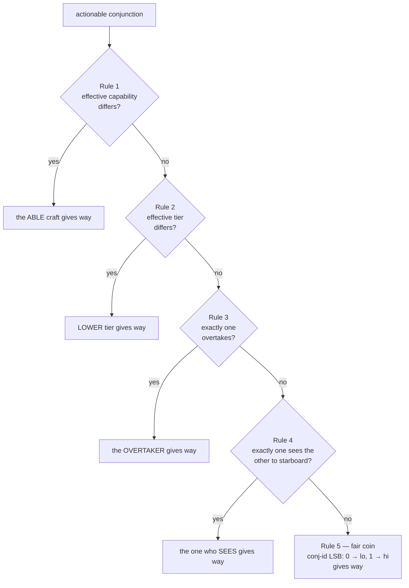

# Starboard Specification — The Rules of the Orbital Road

**Ruleset SB/1 · Specification v0.2 (draft) · `RULESET_ID = 0x53420001`**

*Specification text © 2026 James H, licensed CC BY 4.0. The reference
implementation in `core/` is dual-licensed AGPL-3.0 / commercial.*

---

## 0. Status and conventions

The key words **MUST**, **MUST NOT**, **SHALL**, **SHOULD**, and **MAY** are
to be interpreted as in RFC 2119. Sections marked *(informative)* do not bind
implementations; everything else is normative.

This document is written to be verified by inspection. Every claim the
protocol's safety depends on is stated as a numbered theorem with a proof
short enough to check by hand, and every constant an implementation needs is
pinned in §3.6 — there are no "implementation-defined" values on any path
that two spacecraft must agree about.

## 1. Design axioms *(informative)*

Two satellites facing a close approach must reach the **same** decision about
who gives way using only information both can independently know — even with
no communication. This mirrors maritime COLREGS: a skipper does not radio to
ask "should I give way?"; the geometry answers it. Four axioms follow:

1. **Determinism outranks optimality.** A slightly suboptimal maneuver that
   both craft agree on is safe; an optimal one they disagree on is a
   collision. Wherever this spec had to choose, it chose agreement.
2. **Communication confirms; it never decides.** Any link (Layer 2) may be
   jammed, delayed, or absent. The verdict must already exist without it.
3. **Determinism must survive uncertainty.** Real conjunction assessment is
   probabilistic (covariances, not points). The probability itself is
   therefore a *defined* quantity (§4.5): both craft compute identical bits.
4. **Lies degrade toward physics.** Any assertion a craft could fake is
   backed by a conservative default that preserves safety and pushes the
   decision toward unspoofable geometry (§8).

## 2. Architecture

```
┌──────────────────────────────────────────────────────────────────┐
│ Layer 7  MULTI-BODY WINDOW   deterministic cascade over 3+ craft │
├──────────────────────────────────────────────────────────────────┤
│ Layer 6  MANEUVER            min-Δv Hill-frame burn, reversible  │
├──────────────────────────────────────────────────────────────────┤
│ Layer 3  RETURN TO SLOT      mirror + phase; the flock settles   │
├──────────────────────────────────────────────────────────────────┤
│ Layer 2  HANDSHAKE           optional confirmation (PROTOCOL.md) │
├──────────────────────────────────────────────────────────────────┤
│ Layer 1  RULES OF THE ROAD   the deterministic give-way verdict  │
├──────────────────────────────────────────────────────────────────┤
│ Layer 0  SCREENING           TCA, miss geometry, Starboard-Pc    │
├──────────────────────────────────────────────────────────────────┤
│ Layer C  CANON               frames, ids, lattice, constants     │
└──────────────────────────────────────────────────────────────────┘
```

Layers C, 0, 1, 6, 7 require **no communication**. Layers 2–3 are
enhancements. (Layer numbers are stable names, not a contiguous stack.)

## 3. Layer C — canonical conventions

### 3.1 Frames

* The shared inertial frame is **GCRF** (ECI). All catalog states exchanged
  or screened MUST be expressed in it.
* The **Hill frame** (RIC) of a craft is: x̂ = radial (zenith),
  ẑ = orbit-normal (r̂ × v̂ direction), ŷ = ẑ × x̂ (along-track). Right-handed.
* The **body convention** for Rule 4 is: forward = velocity direction,
  down = −zenith, **starboard = down × forward = v̂ × r̂**. (Facing east with
  zenith up, starboard is south. The handedness is normative; the namesake
  rule depends on it.)

### 3.2 Object identity

A craft's canonical identity is a fixed **12-byte field**: the COSPAR
international designator, uppercase ASCII, left-justified, NUL-padded.
Identity comparison is bytewise unsigned lexicographic and defines a strict
total order over all craft. Every pairwise computation in this spec is
performed on the pair ordered by this comparison (§5.2). Ids MUST be unique;
`lo`/`hi` below always refer to this ordering.

### 3.3 Shared inputs

Layer 1 consumes only **shared inputs**: the two canonical states, the two
registry descriptors (tier, capability, hard-body radius, covariance), and
the shared TCA epoch. A craft MUST NOT feed private knowledge (its own better
ephemeris, unpublished maneuver plans) into the verdict — better data that
the other craft does not have is how two honest implementations disagree.
Private data MAY inform *whether* to escalate to operators; never the verdict.

### 3.4 The quantization lattice

Before any pairwise computation, shared inputs MUST be snapped to the
canonical lattice by round-to-nearest, ties-to-even:

| Quantity   | Quantum          | Value                  |
|------------|------------------|------------------------|
| position   | `Q_POS_M`        | 2⁻¹⁰ m (≈ 0.98 mm)     |
| velocity   | `Q_VEL_MPS`      | 2⁻²⁰ m/s (≈ 0.95 µm/s) |
| covariance | `Q_COV_M2`       | 2⁻²⁰ m²                |
| time       | `Q_TIME_S`       | 2⁻¹⁰ s                 |

Every quantum is an exact power of two, so every lattice point is exactly
representable in binary64 and quantization is idempotent. The lattice is why
two implementations fed the same catalog message compute the same bits: any
sub-quantum disagreement in decoding or unit conversion is erased at the
door. All dead-bands in §5 are ≥ 2¹⁰ quanta, so lattice rounding can never
flip a rule predicate.

### 3.5 The Strict Arithmetic Profile

On the **verdict path** — everything §4 and §5 compute — an implementation
MUST use IEEE-754 binary64 with round-to-nearest-even, MUST NOT use FMA
contraction, reassociation, or "fast-math" transformations, and MUST evaluate
expressions in the operation order this spec and the reference code pin
(dot products expand x, then y, then z; sums accumulate in ascending index
order). The only permitted operations are `+ − × ÷ sqrt` (all correctly
rounded per IEEE-754) and `canon_exp` (§4.6). `sin`, `cos`, `atan2`, `pow`,
and library `exp` are **forbidden on the verdict path** — no libm guarantees
correct rounding for them, and the spec is deliberately formulated so they
are never needed (§4.5). Off the verdict path (maneuver planning, §6) normal
libm is permitted; those quantities are checked to tolerances, not bits.

### 3.6 Canonical constants

All conformant implementations MUST use exactly these values
(`core/include/starboard/canon.hpp`):

| Symbol | Meaning | Value |
|---|---|---|
| `MU_EARTH_M3S2` | gravitational parameter | 3.986004418 × 10¹⁴ |
| `R_SCREEN_M` | coarse screening gate | 8192 m (2¹³) |
| `R_SAFE_M` | required post-maneuver miss | 1024 m (2¹⁰) |
| `PC_ACTIONABLE` | Pc declaring a conjunction | 1.0 × 10⁻⁴ |
| `DEFAULT_HBR_M` | default hard-body radius | 10 m |
| `DEFAULT_VAR_M2` | covariance for silent craft | 10⁶ m² (σ = 1 km) |
| `CHAN_TERMS` | order of the Pc series | 24 |
| `VAR_FLOOR_M2` | plane-covariance eigenfloor | 1 m² |
| `OVERTAKE_COS` | stern-cone half-angle | 0.3826834323650898 (cos 67.5°) |
| `EPS_SPEED_MPS` | speed-ordering dead-band | 0.0625 m/s (2⁻⁴) |
| `EPS_LATERAL_M` | starboard dead-band | 1 m |
| `MANEUVER_MARGIN` | κ, burn target κ·R_SAFE | 1.25 |
| `RETURN_PHASING_ORBITS` | N in mirror+phase return | 2 |
| `TCA_BUCKET_MS` | conjunction-id time bucket | 16384 ms (2¹⁴) |
| `RULESET_ID` | identity of these rules | 0x53420001 |

These are not tuning parameters. They are part of the protocol's identity:
§11 explains why changing any of them removes an implementation from the
network.

## 4. Layer 0 — screening and Starboard-Pc

### 4.1 Inputs

Screening operates on the canonical relative state at the candidate close
approach: `dr = r_B − r_A`, `dv = v_B − v_A`, both craft's quantized
covariances, and combined hard-body radius `R = hbr_A + hbr_B`. How a craft
*obtains* candidate neighbours (catalog, CDM feed, ISL ranging) is
implementation-defined; what it computes from the shared state is not.

### 4.2 Time of closest approach (normative semantics)

Under locally-linear relative motion, `t_raw = −(dr·dv)/(dv·dv)`, with
`t_raw = 0` when `dv·dv < 10⁻¹²` (co-drifting). Then:

* `t_raw ≤ 0` — the pair is at/past closest approach: `t_ca := 0`,
  `miss := dr`, and the pair is *detected* iff `‖dr‖ < R_SCREEN_M`
  (inside the bubble, still receding through it).
* `t_raw > horizon` — closest approach beyond the window: **not detected**.
  (Clamping to the horizon and testing distance there, as naive
  implementations do, mis-detects passes outside the window.)
* otherwise — `t_ca := t_raw`, `miss := dr + dv·t_ca`, detected iff
  `‖miss‖ < R_SCREEN_M`.

Both craft compute identical `t_ca` and `‖miss‖` bits from the same shared
state; the miss *vector* seen by each is the exact negation of the other's.

```
            ORBX ●──────▶ v_B
                  ╲
                   ╲ relative track
     encounter      ╲            e₂ ▲
     plane ⊥ v_rel ──╳────        │
                    ╱ ╲ miss      ●──▶ e₁ = miss direction
        v_A ◀──────● ACME         (in-plane miss = (d, 0))
```

### 4.3 Covariance convention

Position covariances are 3×3 symmetric matrices in GCRF, quantized per §3.4.
The combined covariance is `C = C_A + C_B` (uncorrelated errors — the
standard CDM assumption). A craft that publishes no covariance MUST be
assigned `DEFAULT_VAR_M2 · I` (a deliberately pessimistic 1-km sigma:
silence buys you a wider berth, not a free pass).

### 4.4 The encounter plane (pinned basis)

If `‖dv‖ < 10⁻⁹` m/s the encounter plane does not exist and
`Pc := 1 if d < R else 0` (the R_SAFE floor in §4.7 still applies). Otherwise:

* `n̂ = dv/‖dv‖`
* `e₁* = miss/d` if `d > Q_POS_M`, else the **pinned perpendicular**: the
  unit vector obtained by Gram-Schmidt from the coordinate axis with the
  smallest |component| of n̂ (ties resolved x before y before z)
* `e₁` = Gram-Schmidt of `e₁*` against `n̂` (at an interior TCA miss ⊥ dv
  already; at a clamped TCA it need not be), falling back to the pinned
  perpendicular if degenerate
* `e₂ = n̂ × e₁`

The projected covariance is `a = e₁ᵀCe₁`, `b = e₂ᵀCe₂`, `c = e₁ᵀCe₂` (each
floored per §3.6), and the in-plane miss is `(d_p, 0)` with `d_p = miss·e₁`
— by construction the miss vector lies in span(n̂, e₁).

### 4.5 Starboard-Pc (a defined quantity)

The classical 2-D encounter Pc is the integral of the projected Gaussian
over the hard-body disc. Starboard evaluates it with **Chan's equivalent-area
series**, reformulated so the verdict path needs no eigen-rotation and no
trigonometry:

```
det = a·b − c²                    (floored at VAR_FLOOR²)
u   = R² / sqrt(det)              (dimensionless hard-body area)
v   = d_p² · b / det              (Mahalanobis miss — exact, no rotation)

Pc  = e^(−v/2) · Σ_{m=0}^{24} (v/2)^m/m! · [ 1 − e^(−u/2) · Σ_{k=0}^{m} (u/2)^k/k! ]
```

evaluated with `canon_exp` and the exact recurrence/summation order of the
reference implementation (ascending m, inner terms accumulated by the
running-product recurrence — see `covariance.hpp`).

**Starboard-Pc is defined as this finite expression.** It approximates true
Pc to well within the fidelity of any operational covariance for u, v in the
LEO regime, but its role in the protocol is not to be maximally accurate —
it is to be *identically computable*. Conformance level SB-C2 requires
bit-equality against the pinned vectors.

*Sanity anchor (informative):* for zero miss and isotropic σ,
Pc = 1 − e^(−R²/2σ²), the exact Rayleigh result. And symmetric by
construction: every term depends on squares/quadratics of the relative
geometry, so `Pc(A,B)` and `Pc(B,A)` are the same bits.

### 4.6 `canon_exp`

The one transcendental the verdict path needs. Defined
operation-by-operation in `canon.hpp`: Cody-Waite range reduction with the
fdlibm ln 2 split, a 13-term Taylor polynomial in pinned Horner order, and
an exact `ldexp` scale. Library `exp` MUST NOT be substituted — it is not
correctly rounded, and one ulp of drift near `PC_ACTIONABLE` is a
cross-vendor disagreement. The conformance suite pins `canon_exp` bit
anchors directly (SB-010).

### 4.7 Actionability

A detected conjunction is **actionable** — Layer 1 MUST be evaluated and its
verdict acted on — iff

```
Pc ≥ PC_ACTIONABLE   or   d_miss < R_SAFE_M
```

The second clause is a hard floor: an optimistic covariance is never allowed
to waive a predicted sub-kilometre miss. (With the canonical 20 m combined
hard body, Pc = 10⁻⁴ is reachable only for misses ≲ 1.2 km under
worst-case σ — the thresholds are mutually consistent by construction.)

## 5. Layer 1 — the Rules of the Orbital Road

### 5.1 The verdict

For an actionable conjunction, each craft evaluates the same total function
and obtains a `GiveWayVerdict`: exactly one craft of the pair is **give-way**
(it MUST maneuver per §6); the other is **stand-on** (it MUST hold its
published trajectory until the window closes — predictability is its entire
contribution). If *neither* craft is effectively maneuverable (§8), the
verdict is flagged **advisory**: it names a give-way craft for logging and
operator alerting, but nobody is trusted to act.

### 5.2 The Canonical Pair Transform

All rule predicates are evaluated **once, on the id-ordered pair (lo, hi)**
— never "from my perspective." An implementation MUST order the pair by
§3.2 comparison first, compute the verdict on (lo, hi), then map the result
back to its own role. This is the entire trick that makes Theorem 1 hold by
construction rather than by hoped-for antisymmetry: both craft execute the
identical function on identical arguments in identical order.

### 5.3 The rule chain

Evaluated strictly in order; the first rule that *decides* wins; each rule
either decides or explicitly falls through:



**Rule 1 — capability.** Uses *effective* capability after trust projection
(§8.3). If exactly one craft can maneuver, it gives way. *(COLREGS 18: give
way to a vessel not under command. Asymmetric by physical fact, not
convention.)*

**Rule 2 — tier.** Uses *effective* registry tier: CREWED (3) >
CRITICAL (2) > OPERATIONAL (1) > DEORBITING (0). Lower tier gives way.

**Rule 3 — overtaking.** `overtakes(x, y)` holds iff all three:
(a) `‖v_x‖ − ‖v_y‖ > EPS_SPEED_MPS` — x strictly faster;
(b) x lies in y's **stern cone**: the unit vector from y to x makes an angle
    > 112.5° with v̂_y (equivalently d̂·v̂_y < −OVERTAKE_COS);
(c) the pair is **closing**: `d·(v_x − v_y) < 0` where d = r_x − r_y.
If exactly one of `overtakes(lo,hi)`, `overtakes(hi,lo)` holds, that craft
gives way; otherwise fall through. *(COLREGS 13, with the maritime "abaft
the beam" sector transplanted to the velocity frame.)*

**Rule 4 — starboard.** `sees_on_starboard(x, y)` holds iff
`(r_y − r_x)·(v̂_x × r̂_x) > EPS_LATERAL_M` (§3.1 handedness). If exactly one
craft sees the other to starboard, **the craft that sees gives way** — this
resolves both crossing and offset head-on geometries. Symmetric head-on
(both see, or neither sees within the dead-band) falls through. *(COLREGS
15 — the namesake.)*

**Rule 5 — the fair coin.** The least-significant bit of the conjunction id
(§9.3): `0` → lo gives way, `1` → hi gives way. Always defined, so the chain
is **total**.

### 5.4 Dead-bands *(informative)*

Every geometric predicate compares against a dead-band (EPS_SPEED,
EPS_LATERAL, the cone constant) rather than raw zero. This is not numerical
hygiene alone: it guarantees that inputs that differ by one lattice quantum
cannot sit on opposite sides of a predicate, so "ambiguous" geometry
resolves through explicit fall-through to the coin instead of through the
sign of rounding noise.

### 5.7 Fuel fairness *(informative)*

A convention that always taxes the same craft would be rational to defect
from. Starboard's costs are distributed three ways: (i) asymmetric rules
(1–4) bind by *situation*, and situations alternate between fleet pairs over
time; (ii) the coin flips fresh per encounter — the TCA bucket is hashed
into the id — so persistent standoffs (e.g. constellation neighbours in
symmetric geometry) split the burden 50/50 in expectation, deterministically;
(iii) the give-way maneuver itself is cheap and exactly reversible (§6.5),
so the tax per event is bounded and computable in advance: ≈ Δv·(2 + 2/N).

### 5.8 Theorem 1 — totality and agreement

> **Theorem 1.** For any two craft A ≠ B with canonical shared inputs,
> `evaluate(A, B)` and `evaluate(B, A)` return the same `give_way_id`, the
> same `deciding_rule`, the same `conjunction_id`, and the named craft is
> always exactly one of {A, B}.

*Proof.* By §5.2, both invocations order the pair identically (id comparison
is a strict total order and ids differ), so both execute the same function
on the same ordered arguments. The verdict path is deterministic under §3.5
(every operation is a pinned, correctly-rounded IEEE operation or
`canon_exp`; there is no perspective-dependent input by §3.3 and no
uninitialized or ambient state). Hence both produce identical outputs.
Totality: Rules 1–4 each either decide or fall through; Rule 5 is defined
for every input (the conjunction id always exists); each deciding branch
names `lo` or `hi`. ∎

The proof is two sentences because the construction did the work. The
conformance suite additionally pins it empirically over 4096 pseudo-random
geometries, tiers, and trust states (SB-012).

### 5.9 Theorem 2 — double give-way is safe

> **Theorem 2.** If both craft of a pair execute the give-way maneuver of
> §6.4 (e.g. under trust divergence or a disputed verdict), the achieved
> separation at TCA is strictly larger than if either had maneuvered alone.

*Proof.* Craft X's burn is constructed to displace X at TCA by
`d_X ≥ 0` along `û_X = −miss_X/‖miss_X‖`, i.e. directly away from the
other craft's predicted position. The two miss vectors are exact negations
(`miss_B = −miss_A`), so `û_B = −û_A`: the displacement of B *adds* to the
separation created by A. New separation = `d + d_A + d_B > d + d_A`. In the
degenerate zero-miss case the push direction is cross-track signed by the
canonical order (§6.4), preserving `û_B = −û_A`. ∎

This is the structural answer to "what if the other side's stack is wrong":
the failure mode of disagreement is *extra* clearance, not collision.
(Conformance vector SB-011.)

## 6. Layer 6 — the give-way maneuver

### 6.2 Reference orbit

Maneuvers are planned in the give-way craft's Hill frame (§3.1). The
reference mean motion is `n = sqrt(MU_EARTH / a³)` with `a` the craft's
quantized geocentric radius — reproducible by anyone holding the shared
state; no private orbital elements are involved.

### 6.3 Dynamics

Clohessy-Wiltshire linearized relative dynamics, state-transition blocks
`Φ_rr, Φ_rv, Φ_vr, Φ_vv` as in `frames.hpp` (x radial, y along-track,
z cross-track).

### 6.4 The minimum-Δv burn

Only separation along the miss direction matters, so the constraint is the
scalar `ûᵀ Φ_rv(τ) Δv = Δd`, where `û` is the away direction in the Hill
frame, `τ` the lead time to TCA, and `Δd = κ·R_SAFE − d_miss` the required
extra separation (κ = MANEUVER_MARGIN absorbs the CW-vs-truth modelling
error). The minimum-norm solution is analytic:

```
Δv = Δd · Φ_rvᵀû / ‖Φ_rvᵀû‖²
```

One line, no iteration, no optimizer — suitable for a flight computer. The
resulting burn automatically exploits orbital dynamics (e.g. an along-track
burn to achieve a radial displacement at ~26% less Δv than the naive
impulse; see the demo). Degenerate zero-miss geometry pushes cross-track,
signed + for `lo` and − for `hi` so Theorem 2 survives.

The give-way craft MUST achieve `d ≥ R_SAFE` at TCA by its own action alone
— the plan never assumes cooperation. The stand-on craft MUST NOT maneuver
against the conjunction while the window is open (its predictability is
what the give-way plan is built on), except under §7.5 escalation.

### 6.5 Theorem 3 — the maneuver is exactly reversible

> **Theorem 3.** In CW dynamics, the give-way burn Δv is undone exactly —
> position and velocity offsets both return to zero — by the two-burn
> sequence: **B1** = −Δv + Δv_p applied one full period T after the burn,
> **B2** = −Δv_p applied N·T later, with
> `Δv_p = (n·y_off)/(6πN)` and `y_off = −6π·Δv_y/n`.
> Total return cost = ‖Δv‖ + 2‖Δv_y‖/N.

*Proof.* At t = T after an impulse Δv from the origin: `Φ_rv(2π)` has only
the (y,·) row nonzero, giving position `(0, −6π·Δv_y/n, 0)` — the radial
and cross-track responses vanish at a full period — and `Φ_vv(2π) = I`
gives velocity exactly Δv. Applying −Δv leaves a pure along-track offset at
rest; the orbit's energy is restored (mirror). A tangential impulse Δv_p
drifts −6π·Δv_p/n per period; over N periods with Δv_p as stated the offset
closes exactly, and B2 = −Δv_p arrives on-slot, on-velocity. ∎

Layer 3 (return-to-slot) SHOULD use this mirror+phase return with
N = RETURN_PHASING_ORBITS; a forced quarter-period CW transfer MAY be used
when the slot must be regained quickly (it costs ~n·‖offset‖, an order of
magnitude more). Across a constellation the emergent behaviour is the
murmuration: a threat ripples through, a few craft peel away, and the flock
settles back — every settling trajectory analytic, every cost known in
advance.

## 7. Layer 7 — multi-body windows

### 7.1 The problem

With 3+ craft in one screening window, independent pairwise verdicts can
conflict: C told to stand on for B while told to give way for A. Resolution
must itself be deterministic — every participant must derive the same
assignment without communicating.

### 7.2 Canonical order

The window's conjunctions are sorted by `(TCA bucket, conjunction id)` —
both shared quantities. This is the resolution order everywhere.

### 7.3 The single-pass cascade

Walk the sorted list once, maintaining a role **lock** per craft (first
assigned role is sticky within the window):

* If exactly one craft of a pair is **give-way-locked**, it gives way again
  (`CASCADE`): the already-maneuvering craft absorbs the new constraint into
  one combined burn rather than disturbing a committed stand-on craft.
* A **stand-on-locked** craft is treated as *unable to maneuver* (its
  committed predictability is physically equivalent to Rule 1 incapability);
  the pair then evaluates normally.
* If the resulting give-way craft was stand-on-locked (only possible when
  both craft were), the verdict stands but is flagged **ESCALATED** (§7.5).

### 7.5 Escalation and re-screening

A give-way craft in a window MUST re-screen its planned burn against every
already-resolved pair in the window; the plan MUST NOT create a new
actionable conjunction. ESCALATED pairs additionally require Layer-2
notification or operator involvement — they are the (rare) signature of an
over-constrained window.

### 7.6 Theorem 4 — convergence and agreement

> **Theorem 4.** The cascade terminates in exactly one pass, assigns a role
> to every craft in at least one conjunction, and every participant computes
> the identical assignment.

*Proof.* Termination: the pass is a single loop over a finite list with no
iteration or backtracking. Agreement: the sort key (§7.2) and every verdict
inside the pass (Theorem 1, plus lock state derived only from earlier
entries of the same shared list) are functions of shared inputs only, so
all participants compute the same sequence of verdicts and locks. ∎

Fairness across windows follows from §5.7 — locks reshuffle per window
because the coin and the TCA buckets do.

## 8. The adversarial model

### 8.1 Attack surface

Rules 1–2 consume assertions ("I cannot maneuver", "I am CREWED") that a
hostile, buggy, or merely optimistic operator could misstate. Geometry
(Rules 3–4) cannot be spoofed without physically flying differently; the
coin (Rule 5) is derived from ids and time. So the trust design reduces to:
*what do unverified assertions do?*

### 8.2 Signed capability assertions

A capability assertion binds `(object_id, tier, can_maneuver, epoch)` under
an **Ed25519** signature with a registry-published key (`trust.hpp` pins the
struct; the registry is operationally a certificate-transparency-style log
maintained under the certification program). Craft SHOULD refresh assertions
each mission phase; verifiers cache registry keys on board.

### 8.3 Conservative defaults (Table 8-1)

| Counterpart's assertion | Effective capability | Effective tier |
|---|---|---|
| VERIFIED   | as asserted | as asserted |
| ASSERTED (signature absent/failed) | **cannot maneuver** | OPERATIONAL |
| UNKNOWN (no assertion at all) | **cannot maneuver** | OPERATIONAL |

An unverifiable craft is treated exactly like debris: *you avoid it*. This
is the same posture every operator already takes toward the uncatalogued.

### 8.4 Why lying doesn't pay *(informative, but load-bearing)*

* **Spoofing "I cannot maneuver"** (or refusing to sign): the honest craft
  gives way. The liar gains right-of-way; safety is preserved because
  someone still avoids. Cost: the liar's fleet forfeits the fuel-sharing
  benefits of the coin *and* the lie is a persistent, attributable public
  record — grounds for certification revocation (§11).
* **Spoofing a high tier**: fails closed. An unverified tier clamps to
  OPERATIONAL (never *upward*); a *signed* false tier is cryptographic
  evidence against a registry identity.
* **Both craft unverified**: Rules 1–2 tie out, and the verdict falls
  through to stern cones, starboard geometry, and the coin — quantities an
  adversary can only change by actually moving its spacecraft. **Every lie
  pushes the decision toward physics.**
* **Divergent trust views** (A verifies B, B fails to verify A): the two
  craft may compute different effective descriptors — this is the one place
  symmetric knowledge can break. The failure mode is bounded by Theorem 2:
  the worst case is both craft giving way, which *increases* separation.
  Layer 2, when available, detects the divergence (`dispute` flag) and both
  craft log it.
* **Ghost craft / fake conjunctions**: injecting a fictitious neighbour can
  make a victim burn fuel (a nuisance, bounded by ≈ Δv·(2+2/N) per event)
  but never steers it *into* anything: the give-way displacement is always
  *away* from the claimed object, and real neighbours are re-screened after
  planning (§7.5).

A single Byzantine participant can therefore extract at most the fuel cost
of the encounters it fabricates or wins, while accumulating signed evidence
of misbehaviour. It can never convert the protocol into a weapon, because no
input it controls can make an honest craft reduce its separation from
anything.

## 9. Layer 2 — the handshake *(summary)*

Defined in [`PROTOCOL.md`](PROTOCOL.md). Three messages — INTENT, ACK,
CLEAR — that confirm the verdict, cross-check the deciding rule, and
announce completion. Advisory only: a message that contradicts Layer 1 is a
logged dispute, never an override.

### 9.3 Conjunction identity

`conj_id = FNV-1a-64( lo_id ‖ hi_id ‖ LE64(tca_epoch_ms / TCA_BUCKET_MS) ‖
LE32(RULESET_ID) )`. Both craft derive it independently — the TCA epoch is
bit-identical on both sides because it comes off the shared lattice. The id
seeds Rule 5's coin, orders multi-body windows, and keys every log and
handshake message. Because `RULESET_ID` is folded in, **two stacks running
different rulesets do not even agree on the name of the encounter** — forks
are off-network at the identifier layer, before any verdict is compared.

## 10. Conformance *(summary)*

The conformance suite (`conformance/`, [`CONFORMANCE.md`](CONFORMANCE.md))
is the operational definition of "Starboard compatible": SB-C1 (verdict
conformance) and SB-C2 (bit conformance) against pinned vectors SB-001…012,
covering every rule, every degenerate geometry, the trust downgrades, the
3-body cascade, and the Theorem 1/2 properties directly.

## 11. Why forking loses *(informative)*

A give-way convention has value only through mutual predictability. Suppose
a fork tweaks anything normative — a constant, a dead-band, the rule order,
the Pc series:

1. Its conjunction ids change (§9.3): it can no longer even name encounters
   consistently with the installed base.
2. Where its tweak binds, it computes a *different* give-way craft than
   every compliant neighbour. Sometimes both craft will hold; sometimes both
   will maneuver (safe but wasteful — Theorem 2); the fork's fleet becomes
   the unpredictable one that everyone else's planning cannot rely on.
3. It fails the conformance vectors, so it cannot call itself compatible:
   "Starboard compatible" has a precise, testable, trademark-enforced
   definition — not a vibe.

A fork is thus not a competing standard; it is a **defection from the only
property that made the thing valuable**. The spec is free precisely because
the network effect, the conformance suite, and the mark — not secrecy — are
the moat. (Business consequences: [`STRATEGY.md`](STRATEGY.md).)

---

## Appendix A — symbols

| Symbol | Meaning |
|---|---|
| `dr, dv` | relative position/velocity (hi−lo on the canonical pair) |
| `t_ca` | time to closest approach (s) |
| `d, miss` | miss distance / vector at TCA |
| `C` | combined position covariance (GCRF, m²) |
| `u, v` | Chan series arguments (hard-body area / Mahalanobis miss) |
| `Pc` | Starboard probability of collision (§4.5) |
| `n` | reference mean motion (rad/s) |
| `Φ_rr…Φ_vv` | CW state-transition blocks |
| `κ` | maneuver margin (MANEUVER_MARGIN) |
| `N` | phasing orbits in the mirror+phase return |

## Appendix B — differences from v0.1 *(informative)*

Miss-distance screening → covariance-aware Starboard-Pc; perspective-based
rule evaluation → Canonical Pair Transform with Theorem 1 by construction;
port/starboard handedness corrected; overtaking predicate gained speed and
closing conditions; id-order tie-break → per-encounter fair coin;
Cartesian nudge → analytic min-norm CW burn with mirror+phase return
(Theorem 3); added multi-body cascade (Theorem 4), trust model (§8), strict
arithmetic profile (§3.5), quantization lattice (§3.4), and the conformance
suite as a first-class deliverable.
